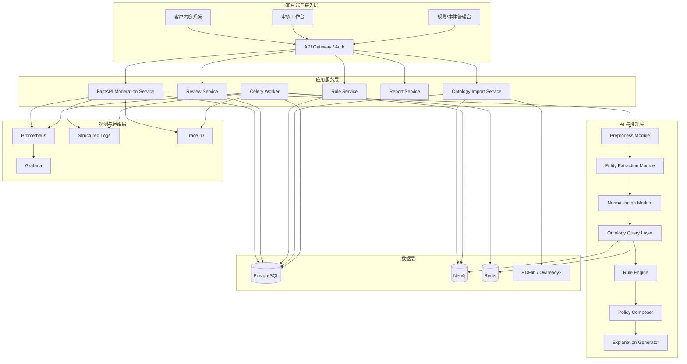
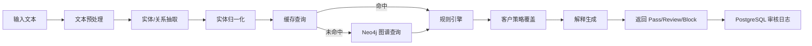
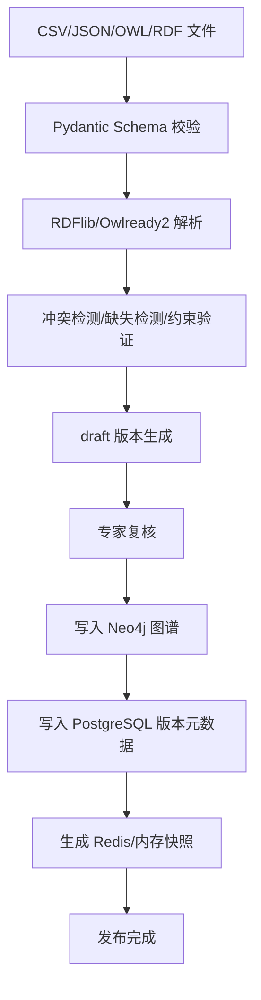
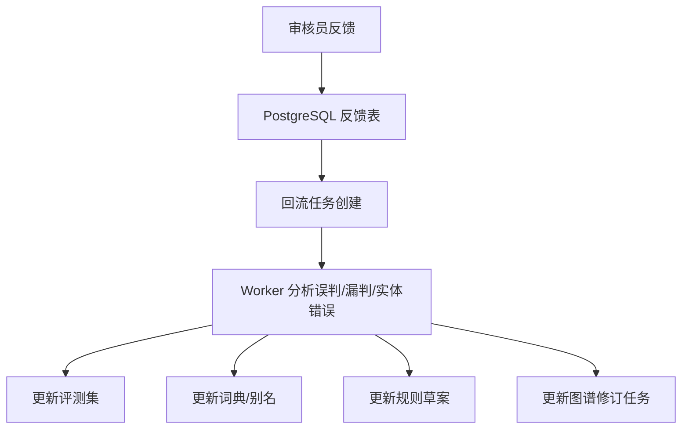

# 岐黄风控盾 QiHuang Shield MVP 架构设计文档

| 字段 | 内容 |
| --- | --- |
| 关联 PRD | `docs/pm/QiHuang_Shield_PRD.md` |
| 关联技术调研 | `docs/design/QiHuang_Shield_Tech_Research.md` |
| 文档版本 | v1.0 |
| 最后更新 | 2026-05-29 |
| 文档状态 | 架构评审稿 |
| 目标读者 | 产品、后端、前端、算法、数据、测试、交付 |

---

## 1. 架构目标与约束

### 1.1 目标

本架构用于支撑岐黄风控盾 MVP 的核心业务闭环：

```text
文本输入 -> 预处理 -> 实体抽取 -> 实体归一化 -> 本体查询 -> 规则推理 -> 决策解释 -> 人工复核 -> 反馈回流
```

架构目标包括：

- 支撑同步审核 API、异步批量审核、审核工作台、本体管理与规则管理。
- 支撑 `Pass / Review / Block` 三态决策及可解释输出。
- 支撑知识图谱查询、知识卡片展示、路径解释与后续 GraphRAG 演进。
- 支撑规则版本、客户策略、审核日志、人工反馈和评测闭环。
- 在 MVP 阶段保持实现复杂度可控，支持快速 POC 和后续扩展。

### 1.2 关键约束

| 约束 | 说明 |
| --- | --- |
| 低延迟 | 同步审核接口要尽量满足 PRD 中的 P95 延迟目标 |
| 可解释 | 高风险结论必须绑定规则、本体事实、证据片段 |
| 可版本化 | 本体、规则、Prompt、模型、策略都要可追溯 |
| 可回滚 | 知识错误、规则错误、策略错误要支持快速回滚 |
| 可扩展 | 未来支持更多场景、多模态、GraphRAG、私有化部署 |
| 可运维 | 监控、日志、告警、任务状态、数据发布必须可观测 |

---

## 2. 架构概述

### 2.1 架构类型选择

**本项目选择：前后端分离架构（MVP 阶段单体后端 + 异步任务 + 双存储数据层）**。

选择理由：

- 前端审核台、规则管理、本体管理、报表大盘需要独立演进，适合前后端分离。
- 后端业务在 MVP 阶段仍然围绕同一审核闭环，暂不需要拆成微服务。
- 审核主链路、规则推理、知识查询、批量任务之间存在共享模型和高耦合，单体后端更利于快速交付。
- 通过 Celery 异步任务池补足离线处理能力，不必一开始就引入微服务治理复杂度。
- 数据层采用 **Neo4j + PostgreSQL 双存储**，兼顾图谱查询能力和事务管理能力。

### 2.2 核心架构原则

- **热路径轻量化**：同步 API 优先使用 Redis/进程内快照，必要时再查询 Neo4j。
- **图谱与事务分离**：Neo4j 负责知识图谱查询，PostgreSQL 负责事务、版本、审计、反馈。
- **在线知识查询单一主路径**：在线本体关系查询统一走 Redis/内存快照或 Neo4j，PostgreSQL 不承载图谱关系检索。
- **版本先行**：本体、规则、策略、Prompt、模型都必须带版本。
- **发布即快照**：知识与规则发布后生成只读快照，供在线审核加载。
- **决策与证据绑定**：任何 Block/Review 都必须能回溯规则、知识事实、证据文本。
- **AI 不直接裁判**：LLM 负责抽取和解释草拟，最终高风险决策由规则与本体证据支撑。

### 2.3 系统架构图



### 2.4 技术栈总览

| 层级 | 技术 | 说明 |
| --- | --- | --- |
| 前端 | React + Vite + Ant Design | 审核工作台、规则台、本体管理台、报表后台 |
| 后端 | FastAPI + Pydantic | API、服务编排、schema 校验、OpenAPI |
| 事务数据库 | PostgreSQL | 规则版本、策略、审核日志、反馈、评测、审计 |
| 图数据库 | Neo4j | 本体实体、关系路径、知识卡片、图谱查询 |
| 缓存 | Redis + 进程内快照 | 热点实体、规则快照、任务状态、幂等与降级 |
| 异步任务 | Celery + Redis | 批量审核、知识导入、评测跑批、异步回流 |
| 本体工具 | RDFlib + Owlready2 | RDF/OWL 导入解析、离线校验、专家验证 |
| 规则引擎 | 自研轻量 JSON DSL | 可解释、可版本化、可模拟测试 |
| 监控 | Prometheus + Grafana | 指标、告警、容量和性能监控 |
| 日志 | JSON Structured Logs + trace_id | 问题排查、审计回放、链路追踪 |
| 部署 | Docker Compose -> Kubernetes | POC 快速部署，后续支持规模化和私有化 |

---

## 3. 系统分层设计

### 3.1 接入层

职责：

- 承接客户系统、审核台、管理台流量。
- 统一鉴权、路由、限流、trace_id 注入。
- 隔离租户和策略上下文。

核心组件：

- API Gateway / Auth
- 租户鉴权中间件
- 审计与访问日志

### 3.2 应用服务层

职责：

- 编排审核主流程。
- 承接人工复核、规则管理、本体导入、报表查询等业务。
- 对上提供 REST API，对下调用知识查询、规则引擎、缓存和异步任务。

服务划分：

| 服务 | 职责 |
| --- | --- |
| Moderation Service | 同步/异步审核入口，主审核编排 |
| Review Service | Review 列表、详情、人工处置、反馈回流 |
| Rule Service | 规则定义、版本发布、客户策略覆盖 |
| Ontology Import Service | 本体导入、校验、图谱写入、版本发布 |
| Report Service | 审核运营指标、报表聚合、质量分析 |
| Worker | 批量审核、评测、图谱更新、回流任务 |

### 3.3 AI 与推理层

职责：

- 文本预处理。
- 实体/关系抽取。
- 实体归一化与候选排序。
- 本体查询与图谱关系读取。
- 规则执行、策略覆盖、解释生成。

模块划分：

| 模块 | 输入 | 输出 |
| --- | --- | --- |
| Preprocess | 原始文本 | 归一化文本、候选片段 |
| Entity Extraction | 文本、schema、场景 | 实体、关系、位置、置信度 |
| Normalization | 实体候选、别名词典、本体候选 | 标准实体、匹配类型、置信度 |
| Ontology Query Layer | 标准实体、关系请求 | 本体事实、路径关系、知识卡片数据 |
| Rule Engine | 实体事实、关系事实、场景、策略 | 命中规则、风险等级、决策候选 |
| Policy Composer | 规则结果、客户策略 | 最终决策 |
| Explanation Generator | 规则结果、本体事实、证据片段 | 可解释文本与结构化解释对象 |

### 3.4 数据层

#### Neo4j 的职责

- 存储知识图谱节点与关系。
- 提供知识卡片、关系路径、多跳解释、相似关系探索。
- 支撑后续 GraphRAG、图谱可视化、案例路径分析。

#### PostgreSQL 的职责

- 存储规则、规则版本、客户策略、审核结果、反馈样本、评测集、审计日志。
- 存储本体发布记录、图谱版本元数据、导入任务和发布状态。
- 承接事务一致性要求高的数据。
- 不作为在线本体关系查询入口，避免事务库承担图谱检索职责。

#### Redis 的职责

- 缓存高频实体与规则快照。
- 缓存热点知识查询结果。
- 管理异步任务状态、幂等键和部分降级链路。

#### RDFlib / Owlready2 的职责

- RDF/OWL 文件解析。
- 导入前一致性校验和约束验证。
- 专家验证与离线推理实验。

---

## 4. 模块架构与职责边界

### 4.1 审核主链路



主链路设计原则：

- 高频事实优先走缓存。
- Neo4j 查询只承载知识图谱事实查询，不承载事务记录写入。
- PostgreSQL 承载审核日志和结果落库。
- LLM 超时或失败时，允许降级到词典/规则路径。

### 4.2 本体导入与发布链路



### 4.3 人工反馈回流链路



---

## 5. 数据架构设计

### 5.1 双存储原则

| 类型 | 存储位置 | 原则 |
| --- | --- | --- |
| 图谱实体与关系 | Neo4j | 面向关系查询、路径解释、知识卡片 |
| 审核日志与事务数据 | PostgreSQL | 面向事务、审计、回溯、报表 |
| 高速读取快照 | Redis / 内存 | 面向热路径、降延迟、降级可用 |
| RDF/OWL 源文件与校验 | 文件 + RDFlib/Owlready2 | 面向导入校验与离线推理 |

补充约束：在线审核链路中的本体事实读取，优先命中 Redis / 内存快照，未命中时查询 Neo4j；PostgreSQL 只提供版本元数据、发布记录和事务数据，不参与在线图谱关系计算。

### 5.2 Neo4j 节点模型

建议节点标签：

- `Material`
- `Alias`
- `Disease`
- `Symptom`
- `Effect`
- `Population`
- `Context`
- `RuleAnchor`
- `KBVersion`

建议节点属性示例：

```text
Material {
  entity_id,
  standard_name,
  material_type,
  food_allowed,
  risk_level,
  status,
  kb_version,
  created_at,
  updated_at
}
```

### 5.3 Neo4j 关系模型

建议关系类型：

- `ALIAS_OF`
- `CONTRAINDICATED_WITH`
- `HAS_EFFECT`
- `ASSOCIATED_WITH_DISEASE`
- `NOT_FOR_POPULATION`
- `ALLOWED_IN_CONTEXT`
- `PROHIBITED_IN_CONTEXT`
- `EVIDENCED_BY`
- `BELONGS_TO_VERSION`

### 5.4 PostgreSQL 核心表

```text
kb_versions
ontology_import_jobs
rules
rule_versions
policy_configs
policy_rule_overrides
moderation_requests
moderation_results
review_tasks
review_feedback
eval_samples
eval_runs
audit_logs
```

### 5.5 数据一致性策略

Neo4j 与 PostgreSQL 不采用实时分布式事务，而采用 **发布式一致性**：

- 所有本体修改先进入 draft。
- 校验通过后生成发布任务。
- 发布任务写入 Neo4j 图谱与 PostgreSQL 元数据。
- 发布完成后生成新的 `kb_version`。
- 在线服务只读取已发布版本，不读取 draft。
- 若发布失败，则版本不切换，保持旧版本可用。

---

## 6. 非功能架构设计

### 6.1 性能设计

| 模块 | 目标 | 设计策略 |
| --- | --- | --- |
| 同步审核 API | P95 尽量满足 PRD 目标 | Redis/快照优先、规则优先、低置信再查图谱 |
| 图谱查询 | 避免重型多跳查询阻塞热路径 | 热路径只做必要查询，复杂路径放工作台或异步 |
| 批量审核 | >= 1000 条/分钟 | Celery worker 横向扩展 |
| 解释生成 | 不阻塞主判定 | 结构化模板优先，必要时 LLM 草拟 |

### 6.2 可用性设计

- 审核热路径支持降级：图谱查询不可用时，回退快照与规则模式。
- Redis 不可用时，允许进程内快照兜底。
- Neo4j 不可用时，高风险词命中进入 Review，避免错误放行。
- PostgreSQL 不可用时，同步接口可降级为只返回结果不持久化的短时保护模式，但默认应告警并限制流量。

### 6.3 安全设计

- 所有租户数据带 `tenant_id`。
- 审核日志脱敏展示。
- 规则、本体、策略修改写审计日志。
- 管理台接口必须带角色权限控制。
- 生产环境中图谱导入和版本发布必须双人复核或审批流控制。

### 6.4 可观测性设计

指标：

- API 请求量、状态码、P50/P95/P99。
- Neo4j 查询耗时、命中率、失败率。
- PostgreSQL 事务耗时、慢查询。
- Redis 命中率、容量、key 热点分布。
- Worker 队列积压、失败重试、任务完成率。
- Review 率、Block 率、人工改判率、解释不可用率。

日志：

- 每次审核必须记录 `trace_id`、`tenant_id`、`kb_version`、`rule_version`、`policy_id`、`model_version`。

---

## 7. 目录结构设计

### 7.1 推荐项目结构

```text
qihuang-shield/
├── apps/
│   ├── api/                       # FastAPI 主应用
│   │   ├── app/
│   │   │   ├── api/
│   │   │   │   └── v1/
│   │   │   │       ├── endpoints/
│   │   │   │       └── router.py
│   │   │   ├── core/
│   │   │   ├── schemas/
│   │   │   ├── services/
│   │   │   ├── repositories/
│   │   │   ├── orchestration/
│   │   │   ├── middleware/
│   │   │   └── main.py
│   │   └── tests/
│   ├── worker/                    # Celery worker
│   │   ├── tasks/
│   │   ├── jobs/
│   │   └── tests/
│   └── web/                       # React + Vite 审核台
│       ├── src/
│       │   ├── pages/
│       │   ├── components/
│       │   ├── services/
│       │   ├── store/
│       │   └── router/
│       └── tests/
├── packages/
│   ├── domain/                    # 领域模型与枚举
│   ├── rule_engine/               # 规则 DSL 与执行器
│   ├── ontology/                  # 图谱查询、快照构建、导入校验
│   ├── llm/                       # 抽取与解释模型适配层
│   ├── observability/             # 日志、指标、trace 工具
│   └── common/                    # 通用工具库
├── infra/
│   ├── docker/
│   ├── compose/
│   ├── k8s/
│   └── scripts/
├── migrations/
│   └── postgres/
├── graph/
│   ├── cypher/
│   ├── seeds/
│   └── constraints/
├── knowledge/
│   ├── source/
│   ├── draft/
│   ├── published/
│   └── validation/
├── docs/
│   ├── pm/
│   └── design/
├── pyproject.toml
└── README.md
```

### 7.2 目录说明

- `apps/api`：主 API 应用，承接审核、复核、规则、本体、报表接口。
- `apps/worker`：批量审核、导入发布、反馈回流、评测任务。
- `apps/web`：审核工作台和管理台前端。
- `packages/rule_engine`：规则 DSL、规则执行器、冲突检测器。
- `packages/ontology`：Neo4j 查询适配、图谱发布、快照生成、RDF/OWL 校验。
- `graph/`：Cypher 脚本、约束定义、图谱初始化数据。
- `knowledge/`：知识源文件、draft 版本、published 版本和校验结果。
- `migrations/postgres`：PostgreSQL 迁移脚本。

---

## 8. 关键架构决策

| 决策 | 方案 | 原因 |
| --- | --- | --- |
| 架构模式 | 前后端分离 + 单体后端 + 异步任务 | MVP 快速交付，复杂度可控 |
| 图谱存储 | Neo4j | 更贴合知识图谱查询、知识卡片和路径解释 |
| 事务存储 | PostgreSQL | 更适合版本、审计、反馈、任务与报表 |
| 缓存策略 | Redis + 内存快照 | 满足热路径性能要求 |
| 本体导入 | RDFlib/Owlready2 离线校验 + Neo4j 发布 | 保留 RDF/OWL 能力，同时支持图数据库上线 |
| 规则执行 | 自研 JSON DSL | 可解释、易版本化、易与产品策略对齐 |
| 同步审核策略 | 缓存优先 + 图谱按需查询 + LLM 可降级 | 稳定性优先 |
| 一致性策略 | 发布式一致性 | 避免双库分布式事务复杂度 |

---

## 9. 后续演进方向

### 9.1 v1.5

- 引入规则模拟测试台。
- 增强 Neo4j 路径解释与知识卡片可视化。
- 支持多客户策略模板和租户隔离部署。
- 引入 OpenTelemetry 做跨服务追踪。

### 9.2 v2.0

- 引入 OCR/ASR 多模态审核。
- 引入 GraphRAG 与相似案例检索。
- 支持更复杂的方剂、疾病、人群多跳知识推理。
- 评估拆分独立的 Graph Service / Reasoning Service。

---

## 10. 架构结论

本项目 MVP 阶段采用：

- **前后端分离架构**
- **FastAPI + React/Vite/Ant Design**
- **Neo4j + PostgreSQL 双存储**
- **Redis + 进程内快照热路径优化**
- **Celery 异步任务池**
- **RDFlib/Owlready2 离线本体校验**
- **自研轻量规则 DSL**

该方案兼顾了：

- 审核主链路的性能与稳定性；
- 知识图谱能力的产品化表达；
- 规则、日志、反馈、评测的事务管理；
- POC 快速交付与后续 GraphRAG 演进空间。
