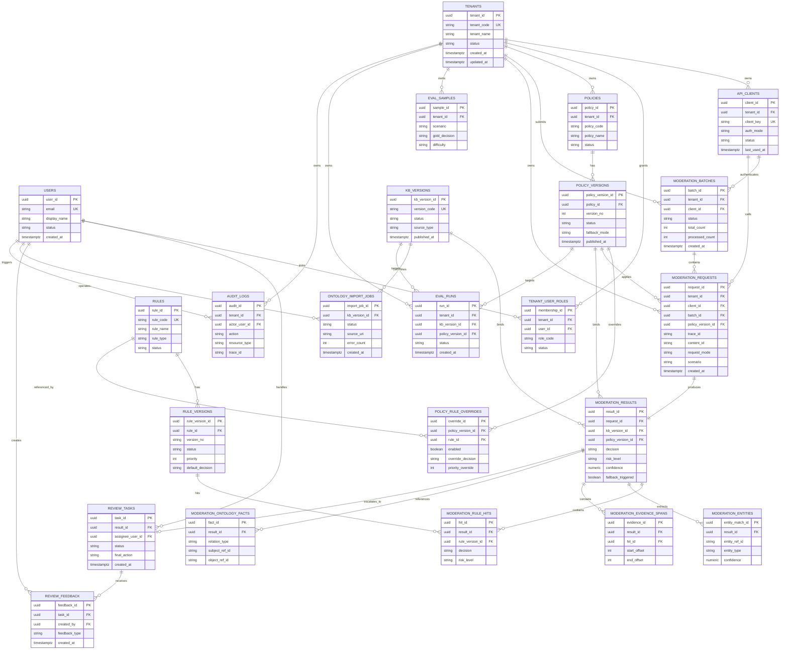

# 岐黄风控盾 QiHuang Shield MVP 数据模型与 API 设计文档

| 字段 | 内容 |
| --- | --- |
| 关联 PRD | `docs/pm/QiHuang_Shield_PRD.md` |
| 关联技术调研 | `docs/design/QiHuang_Shield_Tech_Research.md` |
| 关联架构设计 | `docs/design/QiHuang_Shield_Architecture_Design.md` |
| 文档版本 | v1.0 |
| 最后更新 | 2026-05-29 |
| 文档状态 | 设计稿 |
| 目标读者 | 产品、后端、前端、算法、测试、交付、运维 |

---

## 1. 文档目标与范围

本文档基于当前已确认的 MVP 架构方案，完成以下设计：

- 明确 **Neo4j + PostgreSQL 双存储** 下的数据职责边界；
- 完成 PostgreSQL 事务数据模型设计；
- 完成 Neo4j 图谱数据模型设计；
- 定义核心数据字典、索引、约束与版本化策略；
- 定义面向客户系统、审核工作台、规则中台、本体管理台的 REST API；
- 统一请求/响应格式、认证方式、错误码、幂等与审计要求。

本文档默认约束如下：

- **在线本体查询主路径**：Redis / 进程内快照优先，未命中时查询 Neo4j；
- **PostgreSQL 不承载在线图谱关系检索**，只负责事务、版本、任务、审计、反馈、评测等；
- **Neo4j 为知识图谱主查询层**，承载实体、关系、知识卡片、路径解释；
- **RDFlib / Owlready2** 只用于离线导入、校验和专家验证，不进入同步热路径；
- 所有审核结果必须绑定 `trace_id`、`kb_version`、`rule_version`、`policy_version`、`model_version`。

---

## 2. 设计原则

### 2.1 数据模型原则

- **事务与图谱分层**：事务数据进 PostgreSQL，图谱知识进 Neo4j。
- **版本优先**：知识、本体、规则、策略都必须可发布、可回滚、可追溯。
- **证据留痕**：每次审核必须保留命中规则、实体、证据片段、知识事实。
- **租户隔离**：所有业务数据默认带 `tenant_id`，平台级知识除外。
- **强类型优先**：主键使用 UUID；时间使用 `TIMESTAMPTZ`；灵活结构使用 `JSONB`。
- **热路径最小化**：同步审核仅依赖必要字段，复杂分析放异步链路。

### 2.2 API 设计原则

- **RESTful**，资源导向，统一 `/api/v1` 前缀；
- **外部审核 API 结果结构稳定**，优先兼容客户接入成本；
- **管理台 API 标准化**，支持分页、筛选、排序、审计；
- **统一 trace_id**，便于串联 LLM、规则、图谱、任务与人工反馈；
- **人工操作幂等**，避免重复提交与状态错乱；
- **错误结构统一**，便于前端和客户系统处理。

---

## 3. 数据架构总览

### 3.1 存储职责划分

| 数据类型 | 主存储 | 用途 |
| --- | --- | --- |
| 审核请求/结果/任务/反馈/审计 | PostgreSQL | 事务一致性、日志留痕、报表查询 |
| 规则定义与版本 | PostgreSQL | 版本化、发布、回滚、策略覆盖 |
| 策略定义与版本 | PostgreSQL | 客户级差异化治理 |
| 本体版本元数据、导入任务 | PostgreSQL | 发布流程、状态流转、版本绑定 |
| 实体、别名、关系路径、知识卡片 | Neo4j | 图谱查询、多跳关系、局部解释 |
| 热点规则和知识快照 | Redis / 内存 | 同步审核热路径加速 |
| RDF/OWL 源文件与校验结果 | 文件系统 / 对象存储 + RDFlib/Owlready2 | 导入前校验、专家验证 |

### 3.2 核心业务对象

| 对象 | 说明 | 主存储 |
| --- | --- | --- |
| Tenant | 客户租户 | PostgreSQL |
| ApiClient | 客户 API 调用凭证 | PostgreSQL |
| User | 审核员/运营/知识管理员账号 | PostgreSQL |
| KBVersion | 知识版本元数据 | PostgreSQL |
| Rule / RuleVersion | 规则定义与发布版本 | PostgreSQL |
| Policy / PolicyVersion | 客户策略与发布版本 | PostgreSQL |
| ModerationRequest | 审核请求 | PostgreSQL |
| ModerationResult | 审核结果 | PostgreSQL |
| ReviewTask | 人工复核任务 | PostgreSQL |
| Feedback | 误判/漏判/实体错误等反馈 | PostgreSQL |
| Material / Disease / Effect 等知识节点 | 图谱实体 | Neo4j |
| Relation Path | 图谱关系 | Neo4j |

---

## 4. 数据模型设计

### 4.1 PostgreSQL 逻辑实体关系图（ERD）

> 说明：下图仅描述 PostgreSQL 事务模型；Neo4j 图模型见 4.3。



### 4.2 PostgreSQL 表清单

本文档将架构文档中的核心表进一步细化为以下落地模型：

```text
tenants
api_clients
users
tenant_user_roles
kb_versions
ontology_import_jobs
rules
rule_versions
policies
policy_versions
policy_rule_overrides
moderation_batches
moderation_requests
moderation_results
moderation_rule_hits
moderation_entities
moderation_evidence_spans
moderation_ontology_facts
review_tasks
review_feedback
eval_samples
eval_runs
audit_logs
```

说明：

- `policies + policy_versions` 是对架构文档中 `policy_configs` 的工程化细化，便于发布、回滚与审计；
- `moderation_rule_hits / moderation_entities / moderation_evidence_spans / moderation_ontology_facts` 是对 `moderation_results` 的证据子表拆分，避免单表 JSONB 过重；
- 图谱实体与关系不以 PostgreSQL 主表承载，统一进入 Neo4j。

### 4.3 Neo4j 图模型

#### 4.3.1 节点标签

| 标签 | 说明 | 核心属性 |
| --- | --- | --- |
| `Material` | 药材、食材、普通食品、保健食品原料等物质实体 | `entity_id`, `standard_name`, `material_type`, `food_allowed`, `risk_level`, `status`, `kb_version` |
| `Alias` | 俗名、别名、错别字、谐音词 | `alias_id`, `alias_text`, `alias_type`, `status`, `kb_version` |
| `Disease` | 疾病实体 | `entity_id`, `standard_name`, `icd_ref`, `status`, `kb_version` |
| `Symptom` | 症状实体 | `entity_id`, `standard_name`, `status`, `kb_version` |
| `Effect` | 功效/宣称实体 | `entity_id`, `standard_name`, `effect_type`, `risk_level`, `kb_version` |
| `Population` | 特殊人群 | `entity_id`, `standard_name`, `population_type`, `kb_version` |
| `Context` | 场景实体，如 food_therapy/tea_drink | `context_code`, `context_name`, `kb_version` |
| `RuleAnchor` | 用于解释的规则锚点或知识锚点 | `anchor_id`, `anchor_type`, `title`, `kb_version` |
| `KBVersion` | 发布版本节点 | `kb_version`, `status`, `published_at` |

#### 4.3.2 关系类型

| 关系类型 | 起点 -> 终点 | 含义 | 常用场景 |
| --- | --- | --- | --- |
| `ALIAS_OF` | `Alias -> Material/Disease/Symptom/Effect` | 别名映射 | 实体归一 |
| `CONTRAINDICATED_WITH` | `Material -> Material` | 配伍禁忌 | R002 |
| `HAS_EFFECT` | `Material -> Effect` | 物质关联功效 | 知识卡片 |
| `ASSOCIATED_WITH_DISEASE` | `Effect -> Disease` | 功效与疾病关联 | R003 |
| `NOT_FOR_POPULATION` | `Material -> Population` | 不适宜人群 | R004 |
| `ALLOWED_IN_CONTEXT` | `Material -> Context` | 某场景允许 | R001 |
| `PROHIBITED_IN_CONTEXT` | `Material -> Context` | 某场景禁止 | R001 |
| `EVIDENCED_BY` | `Material/Effect/Relation -> RuleAnchor` | 解释锚点 | 可解释输出 |
| `BELONGS_TO_VERSION` | `AnyNode -> KBVersion` | 版本归属 | 发布与回滚 |

#### 4.3.3 约束与索引建议

| 类型 | 对象 | 建议 |
| --- | --- | --- |
| 唯一约束 | `Material.entity_id` | 唯一 |
| 唯一约束 | `Alias.alias_id` | 唯一 |
| 唯一约束 | `Disease.entity_id` / `Symptom.entity_id` / `Effect.entity_id` | 唯一 |
| 唯一约束 | `KBVersion.kb_version` | 唯一 |
| 普通索引 | `Material.standard_name` | 支持精确检索 |
| 普通索引 | `Material.kb_version` | 支持版本过滤 |
| 普通索引 | `Alias.alias_text` | 支持别名召回 |
| 全文索引 | `Alias.alias_text`, `Material.standard_name` | 支持模糊检索和知识卡片搜索 |

### 4.4 关键枚举定义

#### 4.4.1 决策枚举

| 枚举 | 说明 |
| --- | --- |
| `pass` | 通过或仅记录 |
| `review` | 进入人工复核 |
| `block` | 建议拦截 |

#### 4.4.2 风险等级枚举

| 枚举 | 说明 |
| --- | --- |
| `low` | 低风险 |
| `medium` | 中风险 |
| `high` | 高风险 |
| `critical` | 极高风险 |

#### 4.4.3 批量任务状态枚举

| 枚举 | 说明 |
| --- | --- |
| `created` | 已创建 |
| `running` | 处理中 |
| `partial_success` | 部分成功 |
| `success` | 全部成功 |
| `failed` | 任务失败 |
| `cancelled` | 已取消 |

#### 4.4.4 复核任务状态枚举

| 枚举 | 说明 |
| --- | --- |
| `pending` | 待领取 |
| `claimed` | 已领取 |
| `in_review` | 审核中 |
| `completed` | 已完成 |
| `escalated` | 已升级专家 |
| `closed` | 已关闭 |

#### 4.4.5 本体版本状态枚举

| 枚举 | 说明 |
| --- | --- |
| `draft` | 草稿 |
| `published` | 已发布 |
| `archived` | 已归档 |
| `rolled_back` | 已回滚 |

---

## 5. PostgreSQL 数据字典

> 类型建议：
> - 主键：`UUID`
> - 时间：`TIMESTAMPTZ`
> - 灵活配置：`JSONB`
> - 大文本：`TEXT`
> - 状态类字段：建议使用 PostgreSQL `ENUM` 或受控 `VARCHAR`

### 5.1 tenants

| 字段 | 类型 | 约束 | 说明 |
| --- | --- | --- | --- |
| tenant_id | UUID | PK | 租户主键 |
| tenant_code | VARCHAR(64) | UNIQUE, NOT NULL | 租户编码 |
| tenant_name | VARCHAR(128) | NOT NULL | 租户名称 |
| status | VARCHAR(16) | NOT NULL | `active/inactive` |
| config_json | JSONB | NOT NULL DEFAULT '{}' | 租户扩展配置 |
| created_at | TIMESTAMPTZ | NOT NULL | 创建时间 |
| updated_at | TIMESTAMPTZ | NOT NULL | 更新时间 |

**索引建议**
- `uk_tenants_tenant_code`
- `idx_tenants_status`

### 5.2 api_clients

| 字段 | 类型 | 约束 | 说明 |
| --- | --- | --- | --- |
| client_id | UUID | PK | API 客户端主键 |
| tenant_id | UUID | FK, NOT NULL | 所属租户 |
| client_key | VARCHAR(64) | UNIQUE, NOT NULL | 公钥 / client key |
| client_secret_hash | VARCHAR(255) | NOT NULL | 凭证哈希，不存明文 |
| client_name | VARCHAR(128) | NOT NULL | 客户端名称 |
| auth_mode | VARCHAR(32) | NOT NULL | `aksk/oauth2_client_credentials` |
| allowed_ips | JSONB | NULL | IP 白名单 |
| status | VARCHAR(16) | NOT NULL | `active/revoked` |
| last_used_at | TIMESTAMPTZ | NULL | 最后使用时间 |
| created_at | TIMESTAMPTZ | NOT NULL | 创建时间 |
| updated_at | TIMESTAMPTZ | NOT NULL | 更新时间 |

**索引建议**
- `idx_api_clients_tenant_id`
- `uk_api_clients_client_key`
- `idx_api_clients_status`

### 5.3 users

| 字段 | 类型 | 约束 | 说明 |
| --- | --- | --- | --- |
| user_id | UUID | PK | 用户主键 |
| email | VARCHAR(255) | UNIQUE, NOT NULL | 登录邮箱 |
| display_name | VARCHAR(100) | NOT NULL | 展示名 |
| password_hash | VARCHAR(255) | NOT NULL | 密码哈希 |
| status | VARCHAR(16) | NOT NULL | `active/disabled` |
| last_login_at | TIMESTAMPTZ | NULL | 最后登录时间 |
| created_at | TIMESTAMPTZ | NOT NULL | 创建时间 |
| updated_at | TIMESTAMPTZ | NOT NULL | 更新时间 |

**索引建议**
- `uk_users_email`
- `idx_users_status`

### 5.4 tenant_user_roles

| 字段 | 类型 | 约束 | 说明 |
| --- | --- | --- | --- |
| membership_id | UUID | PK | 关系主键 |
| tenant_id | UUID | FK, NOT NULL | 租户 |
| user_id | UUID | FK, NOT NULL | 用户 |
| role_code | VARCHAR(32) | NOT NULL | `reviewer/expert/operator/ontology_admin/auditor/admin` |
| status | VARCHAR(16) | NOT NULL | `active/inactive` |
| created_at | TIMESTAMPTZ | NOT NULL | 创建时间 |
| updated_at | TIMESTAMPTZ | NOT NULL | 更新时间 |

**索引建议**
- `uk_tenant_user_roles_tenant_user_role` on `(tenant_id, user_id, role_code)`
- `idx_tenant_user_roles_user_id`

### 5.5 kb_versions

| 字段 | 类型 | 约束 | 说明 |
| --- | --- | --- | --- |
| kb_version_id | UUID | PK | 知识版本主键 |
| version_code | VARCHAR(64) | UNIQUE, NOT NULL | 版本号，如 `kb-2026-05-29-01` |
| status | VARCHAR(16) | NOT NULL | `draft/published/archived/rolled_back` |
| source_type | VARCHAR(32) | NOT NULL | `csv/json/owl/rdf/mixed` |
| source_checksum | VARCHAR(128) | NULL | 源文件校验和 |
| validation_report | JSONB | NOT NULL DEFAULT '{}' | 校验结果摘要 |
| snapshot_uri | VARCHAR(512) | NULL | 发布后快照位置 |
| published_by | UUID | FK, NULL | 发布人 |
| published_at | TIMESTAMPTZ | NULL | 发布时间 |
| rollback_from_version_id | UUID | FK, NULL | 回滚来源版本 |
| created_at | TIMESTAMPTZ | NOT NULL | 创建时间 |
| updated_at | TIMESTAMPTZ | NOT NULL | 更新时间 |

**索引建议**
- `uk_kb_versions_version_code`
- `idx_kb_versions_status`
- `idx_kb_versions_published_at`

### 5.6 ontology_import_jobs

| 字段 | 类型 | 约束 | 说明 |
| --- | --- | --- | --- |
| import_job_id | UUID | PK | 导入任务主键 |
| kb_version_id | UUID | FK, NOT NULL | 关联知识版本 |
| source_uri | VARCHAR(512) | NOT NULL | 导入源文件位置 |
| source_type | VARCHAR(32) | NOT NULL | `csv/json/owl/rdf/mixed` |
| status | VARCHAR(32) | NOT NULL | `created/validating/review_pending/publishing/published/failed/cancelled` |
| total_nodes | INTEGER | NOT NULL DEFAULT 0 | 图节点数 |
| total_relations | INTEGER | NOT NULL DEFAULT 0 | 图关系数 |
| warning_count | INTEGER | NOT NULL DEFAULT 0 | 告警数 |
| error_count | INTEGER | NOT NULL DEFAULT 0 | 错误数 |
| validation_report | JSONB | NOT NULL DEFAULT '{}' | 详细校验报告 |
| triggered_by | UUID | FK, NULL | 发起人 |
| started_at | TIMESTAMPTZ | NULL | 开始时间 |
| finished_at | TIMESTAMPTZ | NULL | 结束时间 |
| created_at | TIMESTAMPTZ | NOT NULL | 创建时间 |
| updated_at | TIMESTAMPTZ | NOT NULL | 更新时间 |

**索引建议**
- `idx_ontology_import_jobs_kb_version_id`
- `idx_ontology_import_jobs_status`
- `idx_ontology_import_jobs_created_at`

### 5.7 rules

| 字段 | 类型 | 约束 | 说明 |
| --- | --- | --- | --- |
| rule_id | UUID | PK | 规则主键 |
| rule_code | VARCHAR(32) | UNIQUE, NOT NULL | 规则编码，如 `R003` |
| rule_name | VARCHAR(128) | NOT NULL | 规则名称 |
| rule_type | VARCHAR(32) | NOT NULL | `material_identity/contraindication/effect_claim/population_risk/adversarial_expression/other` |
| owner_user_id | UUID | FK, NULL | 规则负责人 |
| status | VARCHAR(16) | NOT NULL | `active/inactive/archived` |
| description | TEXT | NULL | 规则描述 |
| created_at | TIMESTAMPTZ | NOT NULL | 创建时间 |
| updated_at | TIMESTAMPTZ | NOT NULL | 更新时间 |

**索引建议**
- `uk_rules_rule_code`
- `idx_rules_rule_type`
- `idx_rules_status`

### 5.8 rule_versions

| 字段 | 类型 | 约束 | 说明 |
| --- | --- | --- | --- |
| rule_version_id | UUID | PK | 规则版本主键 |
| rule_id | UUID | FK, NOT NULL | 关联规则 |
| version_no | VARCHAR(32) | NOT NULL | 版本号 |
| status | VARCHAR(16) | NOT NULL | `draft/published/deprecated/archived` |
| priority | INTEGER | NOT NULL | 优先级，数值越大越先执行 |
| default_decision | VARCHAR(16) | NOT NULL | 默认决策 |
| risk_level | VARCHAR(16) | NOT NULL | 默认风险等级 |
| conditions_json | JSONB | NOT NULL | 规则条件 DSL |
| action_json | JSONB | NOT NULL | 规则动作 DSL |
| explanation_template | TEXT | NOT NULL | 解释模板 |
| published_by | UUID | FK, NULL | 发布人 |
| published_at | TIMESTAMPTZ | NULL | 发布时间 |
| rollback_from_version_id | UUID | FK, NULL | 回滚来源版本 |
| created_at | TIMESTAMPTZ | NOT NULL | 创建时间 |
| updated_at | TIMESTAMPTZ | NOT NULL | 更新时间 |

**索引建议**
- `uk_rule_versions_rule_id_version_no` on `(rule_id, version_no)`
- `idx_rule_versions_status`
- `idx_rule_versions_priority`

### 5.9 policies

| 字段 | 类型 | 约束 | 说明 |
| --- | --- | --- | --- |
| policy_id | UUID | PK | 策略主键 |
| tenant_id | UUID | FK, NOT NULL | 所属租户 |
| policy_code | VARCHAR(64) | NOT NULL | 策略编码 |
| policy_name | VARCHAR(128) | NOT NULL | 策略名称 |
| status | VARCHAR(16) | NOT NULL | `active/inactive/archived` |
| description | TEXT | NULL | 策略描述 |
| created_at | TIMESTAMPTZ | NOT NULL | 创建时间 |
| updated_at | TIMESTAMPTZ | NOT NULL | 更新时间 |

**索引建议**
- `uk_policies_tenant_policy_code` on `(tenant_id, policy_code)`
- `idx_policies_tenant_id`

### 5.10 policy_versions

| 字段 | 类型 | 约束 | 说明 |
| --- | --- | --- | --- |
| policy_version_id | UUID | PK | 策略版本主键 |
| policy_id | UUID | FK, NOT NULL | 关联策略 |
| version_no | INTEGER | NOT NULL | 版本号，自增逻辑版本 |
| status | VARCHAR(16) | NOT NULL | `draft/published/archived` |
| scenario_scope | JSONB | NOT NULL DEFAULT '[]' | 适用场景列表 |
| content_type_scope | JSONB | NOT NULL DEFAULT '[]' | 适用内容类型列表 |
| fallback_mode | VARCHAR(32) | NOT NULL | `review_first/best_effort/strict_error` |
| low_confidence_decision | VARCHAR(16) | NOT NULL | 低置信兜底策略 |
| config_json | JSONB | NOT NULL DEFAULT '{}' | 其他阈值和参数 |
| published_by | UUID | FK, NULL | 发布人 |
| published_at | TIMESTAMPTZ | NULL | 发布时间 |
| created_at | TIMESTAMPTZ | NOT NULL | 创建时间 |
| updated_at | TIMESTAMPTZ | NOT NULL | 更新时间 |

**索引建议**
- `uk_policy_versions_policy_id_version_no` on `(policy_id, version_no)`
- `idx_policy_versions_status`

### 5.11 policy_rule_overrides

| 字段 | 类型 | 约束 | 说明 |
| --- | --- | --- | --- |
| override_id | UUID | PK | 覆盖项主键 |
| policy_version_id | UUID | FK, NOT NULL | 关联策略版本 |
| rule_id | UUID | FK, NOT NULL | 覆盖的规则 |
| enabled | BOOLEAN | NOT NULL DEFAULT TRUE | 是否启用 |
| override_decision | VARCHAR(16) | NULL | 覆盖默认决策 |
| override_risk_level | VARCHAR(16) | NULL | 覆盖风险等级 |
| priority_override | INTEGER | NULL | 覆盖优先级 |
| params_json | JSONB | NOT NULL DEFAULT '{}' | 阈值/例外参数 |
| created_at | TIMESTAMPTZ | NOT NULL | 创建时间 |
| updated_at | TIMESTAMPTZ | NOT NULL | 更新时间 |

**索引建议**
- `uk_policy_rule_overrides_policy_rule` on `(policy_version_id, rule_id)`
- `idx_policy_rule_overrides_rule_id`

### 5.12 moderation_batches

| 字段 | 类型 | 约束 | 说明 |
| --- | --- | --- | --- |
| batch_id | UUID | PK | 批量任务主键 |
| tenant_id | UUID | FK, NOT NULL | 所属租户 |
| client_id | UUID | FK, NULL | 调用客户端 |
| batch_name | VARCHAR(128) | NULL | 批量任务名称 |
| callback_url | VARCHAR(512) | NULL | 回调地址 |
| status | VARCHAR(32) | NOT NULL | `created/running/partial_success/success/failed/cancelled` |
| total_count | INTEGER | NOT NULL | 总条数 |
| processed_count | INTEGER | NOT NULL DEFAULT 0 | 已处理条数 |
| success_count | INTEGER | NOT NULL DEFAULT 0 | 成功条数 |
| failed_count | INTEGER | NOT NULL DEFAULT 0 | 失败条数 |
| created_at | TIMESTAMPTZ | NOT NULL | 创建时间 |
| started_at | TIMESTAMPTZ | NULL | 开始时间 |
| finished_at | TIMESTAMPTZ | NULL | 完成时间 |
| updated_at | TIMESTAMPTZ | NOT NULL | 更新时间 |

**索引建议**
- `idx_moderation_batches_tenant_id_status`
- `idx_moderation_batches_created_at`

### 5.13 moderation_requests

| 字段 | 类型 | 约束 | 说明 |
| --- | --- | --- | --- |
| request_id | UUID | PK | 审核请求主键 |
| tenant_id | UUID | FK, NOT NULL | 租户 |
| client_id | UUID | FK, NULL | 调用客户端 |
| batch_id | UUID | FK, NULL | 批量任务 |
| policy_version_id | UUID | FK, NULL | 生效策略版本 |
| trace_id | VARCHAR(64) | NOT NULL | 链路追踪 ID |
| content_id | VARCHAR(128) | NOT NULL | 客户侧内容 ID |
| request_mode | VARCHAR(16) | NOT NULL | `sync/batch` |
| content_type | VARCHAR(32) | NOT NULL | `note/comment/product_detail/transcript/other` |
| scenario | VARCHAR(32) | NOT NULL | `food_therapy/tea_drink/weight_loss/general_health/other` |
| content_text | TEXT | NOT NULL | 审核原文 |
| content_text_hash | VARCHAR(128) | NOT NULL | 原文哈希 |
| metadata_json | JSONB | NOT NULL DEFAULT '{}' | 扩展元数据 |
| idempotency_key | VARCHAR(128) | NULL | 幂等键 |
| created_at | TIMESTAMPTZ | NOT NULL | 创建时间 |
| updated_at | TIMESTAMPTZ | NOT NULL | 更新时间 |

**索引建议**
- `idx_moderation_requests_tenant_id_created_at`
- `idx_moderation_requests_trace_id`
- `idx_moderation_requests_batch_id`
- `idx_moderation_requests_content_id`
- `uk_moderation_requests_tenant_idempotency` on `(tenant_id, idempotency_key)` where `idempotency_key is not null`

### 5.14 moderation_results

| 字段 | 类型 | 约束 | 说明 |
| --- | --- | --- | --- |
| result_id | UUID | PK | 审核结果主键 |
| request_id | UUID | FK, UNIQUE, NOT NULL | 对应请求 |
| tenant_id | UUID | FK, NOT NULL | 租户 |
| trace_id | VARCHAR(64) | NOT NULL | 追踪 ID |
| kb_version_id | UUID | FK, NOT NULL | 命中的知识版本 |
| policy_version_id | UUID | FK, NULL | 生效策略版本 |
| decision | VARCHAR(16) | NOT NULL | `pass/review/block` |
| risk_level | VARCHAR(16) | NOT NULL | `low/medium/high/critical` |
| confidence | NUMERIC(5,4) | NOT NULL | 置信度 |
| recommended_action | VARCHAR(32) | NOT NULL | `allow/reject/modify_required/expert_review/manual_confirm_block/block_or_manual_confirm` |
| fallback_triggered | BOOLEAN | NOT NULL DEFAULT FALSE | 是否触发降级 |
| fallback_reason | VARCHAR(64) | NULL | 降级原因 |
| prompt_version | VARCHAR(64) | NULL | Prompt 版本 |
| model_version | VARCHAR(64) | NULL | 模型版本 |
| latency_ms | INTEGER | NOT NULL | 本次耗时 |
| explanation | TEXT | NOT NULL | 解释文案 |
| explanation_structured | JSONB | NOT NULL DEFAULT '{}' | 结构化解释 |
| raw_extraction_json | JSONB | NULL | 原始抽取结果 |
| created_at | TIMESTAMPTZ | NOT NULL | 创建时间 |
| updated_at | TIMESTAMPTZ | NOT NULL | 更新时间 |

**索引建议**
- `idx_moderation_results_tenant_decision_created`
- `idx_moderation_results_trace_id`
- `idx_moderation_results_kb_version_id`
- `idx_moderation_results_policy_version_id`

### 5.15 moderation_rule_hits

| 字段 | 类型 | 约束 | 说明 |
| --- | --- | --- | --- |
| hit_id | UUID | PK | 规则命中主键 |
| result_id | UUID | FK, NOT NULL | 所属审核结果 |
| rule_id | UUID | FK, NOT NULL | 命中规则 |
| rule_version_id | UUID | FK, NOT NULL | 命中规则版本 |
| decision | VARCHAR(16) | NOT NULL | 该规则输出决策 |
| risk_level | VARCHAR(16) | NOT NULL | 该规则风险等级 |
| priority | INTEGER | NOT NULL | 执行优先级 |
| reason | TEXT | NOT NULL | 命中原因 |
| matched_facts_json | JSONB | NOT NULL DEFAULT '{}' | 命中事实 |
| created_at | TIMESTAMPTZ | NOT NULL | 创建时间 |

**索引建议**
- `idx_moderation_rule_hits_result_id`
- `idx_moderation_rule_hits_rule_version_id`
- `idx_moderation_rule_hits_rule_id`

### 5.16 moderation_entities

| 字段 | 类型 | 约束 | 说明 |
| --- | --- | --- | --- |
| entity_match_id | UUID | PK | 实体匹配主键 |
| result_id | UUID | FK, NOT NULL | 所属审核结果 |
| entity_ref_id | VARCHAR(64) | NULL | 对应 Neo4j `entity_id` |
| source_text | VARCHAR(255) | NOT NULL | 原文实体文本 |
| standard_name | VARCHAR(255) | NULL | 标准名 |
| entity_type | VARCHAR(32) | NOT NULL | `material/disease/symptom/effect/population/context/other` |
| start_offset | INTEGER | NOT NULL | 起始位置 |
| end_offset | INTEGER | NOT NULL | 结束位置 |
| confidence | NUMERIC(5,4) | NOT NULL | 实体置信度 |
| normalization_status | VARCHAR(16) | NOT NULL | `exact/alias/fuzzy/unresolved` |
| kb_version_id | UUID | FK, NOT NULL | 归一化使用的知识版本 |
| extra_json | JSONB | NOT NULL DEFAULT '{}' | 其他附加信息 |
| created_at | TIMESTAMPTZ | NOT NULL | 创建时间 |

**索引建议**
- `idx_moderation_entities_result_id`
- `idx_moderation_entities_entity_ref_id`
- `idx_moderation_entities_entity_type`

### 5.17 moderation_evidence_spans

| 字段 | 类型 | 约束 | 说明 |
| --- | --- | --- | --- |
| evidence_id | UUID | PK | 证据片段主键 |
| result_id | UUID | FK, NOT NULL | 所属审核结果 |
| hit_id | UUID | FK, NULL | 关联规则命中 |
| entity_match_id | UUID | FK, NULL | 关联实体 |
| evidence_type | VARCHAR(32) | NOT NULL | `raw_text/entity/graph_fact/rule_explanation` |
| text_excerpt | VARCHAR(500) | NOT NULL | 证据文本 |
| start_offset | INTEGER | NOT NULL | 起始位置 |
| end_offset | INTEGER | NOT NULL | 结束位置 |
| created_at | TIMESTAMPTZ | NOT NULL | 创建时间 |

**索引建议**
- `idx_moderation_evidence_spans_result_id`
- `idx_moderation_evidence_spans_hit_id`

### 5.18 moderation_ontology_facts

| 字段 | 类型 | 约束 | 说明 |
| --- | --- | --- | --- |
| fact_id | UUID | PK | 本体事实主键 |
| result_id | UUID | FK, NOT NULL | 所属审核结果 |
| kb_version_id | UUID | FK, NOT NULL | 使用的知识版本 |
| relation_type | VARCHAR(64) | NOT NULL | 关系类型 |
| subject_ref_id | VARCHAR(64) | NOT NULL | 主体实体 ID |
| object_ref_id | VARCHAR(64) | NULL | 客体实体 ID |
| object_text | VARCHAR(255) | NULL | 客体展示文本 |
| path_depth | SMALLINT | NOT NULL DEFAULT 1 | 路径深度 |
| fact_payload | JSONB | NOT NULL DEFAULT '{}' | 关系详情 |
| created_at | TIMESTAMPTZ | NOT NULL | 创建时间 |

**索引建议**
- `idx_moderation_ontology_facts_result_id`
- `idx_moderation_ontology_facts_subject_ref_id`
- `idx_moderation_ontology_facts_relation_type`

### 5.19 review_tasks

| 字段 | 类型 | 约束 | 说明 |
| --- | --- | --- | --- |
| task_id | UUID | PK | 复核任务主键 |
| result_id | UUID | FK, UNIQUE, NOT NULL | 来源审核结果 |
| tenant_id | UUID | FK, NOT NULL | 租户 |
| assignee_user_id | UUID | FK, NULL | 当前处理人 |
| status | VARCHAR(16) | NOT NULL | `pending/claimed/in_review/completed/escalated/closed` |
| queue_name | VARCHAR(64) | NULL | 队列名称 |
| sla_due_at | TIMESTAMPTZ | NULL | SLA 截止时间 |
| final_decision | VARCHAR(16) | NULL | 人工最终决策 |
| final_action | VARCHAR(32) | NULL | 人工最终动作 |
| overwrite_system_decision | BOOLEAN | NOT NULL DEFAULT FALSE | 是否覆盖系统决策 |
| resolution_reason | VARCHAR(128) | NULL | 处置原因枚举 |
| resolution_note | TEXT | NULL | 审核备注 |
| claimed_at | TIMESTAMPTZ | NULL | 领取时间 |
| completed_at | TIMESTAMPTZ | NULL | 完成时间 |
| created_at | TIMESTAMPTZ | NOT NULL | 创建时间 |
| updated_at | TIMESTAMPTZ | NOT NULL | 更新时间 |

**索引建议**
- `idx_review_tasks_tenant_status`
- `idx_review_tasks_assignee_user_id`
- `idx_review_tasks_sla_due_at`

### 5.20 review_feedback

| 字段 | 类型 | 约束 | 说明 |
| --- | --- | --- | --- |
| feedback_id | UUID | PK | 反馈主键 |
| task_id | UUID | FK, NOT NULL | 所属复核任务 |
| result_id | UUID | FK, NOT NULL | 所属审核结果 |
| tenant_id | UUID | FK, NOT NULL | 租户 |
| feedback_type | VARCHAR(32) | NOT NULL | `false_positive/false_negative/entity_error/rule_not_applicable/explanation_unclear/other` |
| target_rule_id | UUID | FK, NULL | 关联规则 |
| target_rule_version_id | UUID | FK, NULL | 关联规则版本 |
| target_entity_ref_id | VARCHAR(64) | NULL | 关联实体 ID |
| comment | TEXT | NULL | 反馈说明 |
| labels_json | JSONB | NOT NULL DEFAULT '{}' | 标签信息 |
| created_by | UUID | FK, NOT NULL | 创建人 |
| created_at | TIMESTAMPTZ | NOT NULL | 创建时间 |

**索引建议**
- `idx_review_feedback_task_id`
- `idx_review_feedback_result_id`
- `idx_review_feedback_feedback_type`

### 5.21 eval_samples

| 字段 | 类型 | 约束 | 说明 |
| --- | --- | --- | --- |
| sample_id | UUID | PK | 样本主键 |
| tenant_id | UUID | FK, NULL | 租户，可为空表示平台公共样本 |
| sample_set_name | VARCHAR(128) | NOT NULL | 样本集名称 |
| content_text | TEXT | NOT NULL | 样本文本 |
| content_type | VARCHAR(32) | NOT NULL | 内容类型 |
| scenario | VARCHAR(32) | NOT NULL | 场景 |
| gold_decision | VARCHAR(16) | NOT NULL | 金标准决策 |
| gold_risk_level | VARCHAR(16) | NULL | 金标准风险等级 |
| gold_entities_json | JSONB | NOT NULL DEFAULT '[]' | 标准实体 |
| gold_rules_json | JSONB | NOT NULL DEFAULT '[]' | 标准规则 |
| difficulty | VARCHAR(16) | NOT NULL | `easy/medium/hard/adversarial` |
| source_type | VARCHAR(32) | NOT NULL | `poc/customer/production_feedback/synthetic` |
| created_at | TIMESTAMPTZ | NOT NULL | 创建时间 |
| updated_at | TIMESTAMPTZ | NOT NULL | 更新时间 |

**索引建议**
- `idx_eval_samples_tenant_id`
- `idx_eval_samples_sample_set_name`
- `idx_eval_samples_difficulty`

### 5.22 eval_runs

| 字段 | 类型 | 约束 | 说明 |
| --- | --- | --- | --- |
| run_id | UUID | PK | 评测运行主键 |
| tenant_id | UUID | FK, NULL | 租户 |
| run_name | VARCHAR(128) | NOT NULL | 运行名称 |
| status | VARCHAR(16) | NOT NULL | `created/running/success/failed` |
| target_kb_version_id | UUID | FK, NOT NULL | 目标知识版本 |
| target_policy_version_id | UUID | FK, NULL | 目标策略版本 |
| target_model_version | VARCHAR(64) | NULL | 目标模型版本 |
| metrics_json | JSONB | NOT NULL DEFAULT '{}' | Precision/Recall/F1 等指标 |
| result_summary_json | JSONB | NOT NULL DEFAULT '{}' | 结果摘要 |
| started_at | TIMESTAMPTZ | NULL | 开始时间 |
| finished_at | TIMESTAMPTZ | NULL | 结束时间 |
| created_at | TIMESTAMPTZ | NOT NULL | 创建时间 |

**索引建议**
- `idx_eval_runs_status`
- `idx_eval_runs_target_kb_version_id`
- `idx_eval_runs_created_at`

### 5.23 audit_logs

| 字段 | 类型 | 约束 | 说明 |
| --- | --- | --- | --- |
| audit_id | UUID | PK | 审计主键 |
| tenant_id | UUID | FK, NULL | 租户 |
| actor_type | VARCHAR(16) | NOT NULL | `user/api_client/system` |
| actor_user_id | UUID | FK, NULL | 操作用户 |
| actor_client_id | UUID | FK, NULL | 操作客户端 |
| action | VARCHAR(64) | NOT NULL | 动作，如 `policy_publish` |
| resource_type | VARCHAR(64) | NOT NULL | 资源类型 |
| resource_id | VARCHAR(64) | NOT NULL | 资源 ID |
| change_summary | JSONB | NOT NULL DEFAULT '{}' | 变更摘要 |
| trace_id | VARCHAR(64) | NULL | 追踪 ID |
| ip_address | INET | NULL | 来源 IP |
| user_agent | VARCHAR(255) | NULL | User-Agent |
| created_at | TIMESTAMPTZ | NOT NULL | 创建时间 |

**索引建议**
- `idx_audit_logs_tenant_resource_created`
- `idx_audit_logs_trace_id`
- `idx_audit_logs_action`

---

## 6. 数据一致性、生命周期与发布策略

### 6.1 本体发布一致性

Neo4j 与 PostgreSQL 不采用分布式事务，而采用 **发布式一致性**：

1. 创建 `kb_versions` 草稿版本；
2. 创建 `ontology_import_jobs` 并执行字段校验、关系校验、一致性校验；
3. 校验通过后写入 Neo4j 新版本节点与关系；
4. 写入 PostgreSQL 的发布记录和版本元数据；
5. 生成 Redis / 内存快照；
6. 切换当前可读版本；
7. 若任一步失败，则不切换线上版本。

### 6.2 审核结果版本绑定

每条 `moderation_results` 必须固化以下版本：

- `kb_version_id`
- `policy_version_id`
- `rule_version_id`（通过 `moderation_rule_hits` 绑定）
- `model_version`
- `prompt_version`

这样才能确保：

- 后续追责时可复盘；
- 工作台展示不会随知识更新漂移；
- 误判分析能准确回溯到规则和知识版本。

### 6.3 数据保留建议

| 数据 | 保留建议 |
| --- | --- |
| 审核请求/结果 | 默认保留 180-365 天，按客户合同可配置 |
| 审计日志 | 不低于 365 天 |
| 反馈与评测数据 | 长期保留 |
| 导入任务明细 | 至少保留最近 20 个版本 |
| 图谱旧版本 | 默认保留最近 N 个可回滚版本 |

---

## 7. API 设计

### 7.1 API 规范

- **风格**：RESTful
- **版本**：`/api/v1`
- **数据格式**：`application/json`
- **字符集**：UTF-8
- **时间格式**：ISO 8601
- **字段命名**：`snake_case`
- **分页参数**：`page`, `page_size`
- **排序参数**：`sort_by`, `sort_order`
- **追踪头**：`X-Trace-Id`（可选，服务端可生成）
- **幂等头**：`Idempotency-Key`（推荐用于创建类接口）

### 7.2 认证与授权

#### 7.2.1 外部客户审核 API

适用于：

- `/api/v1/moderation/*`
- `/api/v1/reports/*`（客户只读报表）

推荐认证方式：

- **AK/SK 签名**，适合服务间集成；
- 或 **OAuth2 Client Credentials**，适合标准企业接入。

请求头示例：

```text
Authorization: Bearer <access_token>
X-Tenant-Code: tenant_demo
Idempotency-Key: 2a67f7f1-9e1c-4e8e-b0e2-50f5dc3d2fd0
```

#### 7.2.2 工作台与管理台 API

适用于：

- `/api/v1/auth/*`
- `/api/v1/review-tasks/*`
- `/api/v1/rules/*`
- `/api/v1/policies/*`
- `/api/v1/ontology/*`

推荐认证方式：

- **JWT Bearer Token**

#### 7.2.3 角色建议

| 角色 | 能力 |
| --- | --- |
| `reviewer` | 查看 Review 队列、提交人工处置、创建反馈 |
| `expert` | 处理升级任务、维护专业备注 |
| `operator` | 管理规则/策略、查看报表 |
| `ontology_admin` | 导入知识、发布版本、回滚版本 |
| `auditor` | 查看审计日志和发布记录 |
| `admin` | 全局管理 |

### 7.3 通用响应格式

#### 7.3.1 管理台与中后台 API

成功响应：

```json
{
  "status": "success",
  "trace_id": "trc_01JXYZ...",
  "data": {},
  "meta": {
    "page": 1,
    "page_size": 20,
    "total": 100,
    "total_pages": 5
  }
}
```

错误响应：

```json
{
  "status": "error",
  "trace_id": "trc_01JXYZ...",
  "error": {
    "code": "invalid_request",
    "message": "content_text is required",
    "retryable": false,
    "details": [
      {
        "field": "content_text",
        "message": "must not be empty"
      }
    ]
  }
}
```

#### 7.3.2 外部审核 API

为兼容客户系统接入，**审核结果接口保留扁平结构**，但仍包含 `status` 和 `trace_id`。

### 7.4 通用错误码

| 错误码 | HTTP 状态码 | 说明 |
| --- | --- | --- |
| `invalid_request` | 400 | 参数错误 |
| `unauthorized` | 401 | 未认证 |
| `forbidden` | 403 | 无权限 |
| `not_found` | 404 | 资源不存在 |
| `conflict` | 409 | 资源冲突 |
| `content_too_large` | 413 | 文本过长 |
| `rate_limited` | 429 | 超出限流 |
| `ontology_unavailable` | 503 | 本体服务不可用 |
| `dependency_unavailable` | 503 | 外部依赖不可用 |
| `internal_error` | 500 | 系统内部错误 |

### 7.5 API 资源清单

| 模块 | 方法 | 路径 | 用途 |
| --- | --- | --- | --- |
| 认证 | POST | `/api/v1/auth/login` | 工作台登录 |
| 认证 | GET | `/api/v1/auth/me` | 获取当前用户 |
| 审核 | POST | `/api/v1/moderation/sync` | 同步审核 |
| 审核 | POST | `/api/v1/moderation/batches` | 创建批量审核任务 |
| 审核 | GET | `/api/v1/moderation/batches/{batch_id}` | 查询批量任务状态 |
| 审核 | GET | `/api/v1/moderation/batches/{batch_id}/items` | 查询批量任务结果 |
| 复核 | GET | `/api/v1/review-tasks` | 复核列表 |
| 复核 | GET | `/api/v1/review-tasks/{task_id}` | 复核详情 |
| 复核 | POST | `/api/v1/review-tasks/{task_id}/claim` | 领取任务 |
| 复核 | POST | `/api/v1/review-tasks/{task_id}/submit` | 提交人工处置 |
| 复核 | POST | `/api/v1/review-tasks/{task_id}/feedback` | 提交反馈 |
| 规则 | GET | `/api/v1/rules` | 规则列表 |
| 规则 | POST | `/api/v1/rules` | 创建规则 |
| 规则 | GET | `/api/v1/rules/{rule_id}` | 规则详情 |
| 规则 | POST | `/api/v1/rules/{rule_id}/versions` | 新建规则版本 |
| 规则 | POST | `/api/v1/rules/{rule_id}/versions/{rule_version_id}/publish` | 发布规则版本 |
| 策略 | GET | `/api/v1/policies` | 策略列表 |
| 策略 | POST | `/api/v1/policies` | 创建策略 |
| 策略 | GET | `/api/v1/policies/{policy_id}` | 策略详情 |
| 策略 | POST | `/api/v1/policies/{policy_id}/versions` | 创建策略版本 |
| 策略 | POST | `/api/v1/policies/{policy_id}/versions/{policy_version_id}/publish` | 发布策略版本 |
| 本体 | POST | `/api/v1/ontology/import-jobs` | 创建导入任务 |
| 本体 | GET | `/api/v1/ontology/import-jobs/{import_job_id}` | 查询导入任务 |
| 本体 | POST | `/api/v1/ontology/import-jobs/{import_job_id}/publish` | 发布知识版本 |
| 本体 | GET | `/api/v1/ontology/entities/{entity_id}` | 查询实体详情 |
| 本体 | GET | `/api/v1/ontology/knowledge-cards/{entity_id}` | 查询知识卡片 |
| 报表 | GET | `/api/v1/reports/overview` | 总览指标 |
| 报表 | GET | `/api/v1/reports/rule-hits` | 规则命中统计 |
| 报表 | GET | `/api/v1/reports/review-quality` | 人工改判与质量分析 |

---

## 8. 详细接口设计

### 8.1 认证 API

#### 8.1.1 POST /api/v1/auth/login

**用途**：工作台登录。

**Request**

```json
{
  "email": "reviewer@example.com",
  "password": "******"
}
```

**Response**

```json
{
  "status": "success",
  "trace_id": "trc_01JXYZ...",
  "data": {
    "access_token": "jwt-token",
    "token_type": "Bearer",
    "expires_in": 7200,
    "user": {
      "user_id": "uuid",
      "email": "reviewer@example.com",
      "display_name": "审核员A",
      "roles": ["reviewer"]
    }
  }
}
```

#### 8.1.2 GET /api/v1/auth/me

**用途**：获取当前登录用户。

---

### 8.2 审核 API

#### 8.2.1 POST /api/v1/moderation/sync

**用途**：单条文本同步审核。

**Request Body**

```json
{
  "content_id": "note_123456",
  "content_text": "这个代茶饮三天降血糖，适合长期喝。",
  "content_type": "note",
  "scenario": "tea_drink",
  "policy_id": "pol_default_cn",
  "tenant_id": "tenant_demo",
  "metadata": {
    "author_id": "author_001",
    "source": "ugc_note"
  }
}
```

**成功响应**

```json
{
  "status": "success",
  "trace_id": "trc_01JXYZ...",
  "content_id": "note_123456",
  "decision": "Block",
  "risk_level": "High",
  "confidence": 0.92,
  "fallback_triggered": false,
  "hit_rules": [
    {
      "rule_id": "R003",
      "rule_name": "功效宣称越界",
      "rule_version": "1.0.0",
      "risk_level": "High",
      "decision": "Block",
      "reason": "普通食疗/茶饮内容宣称治疗疾病"
    }
  ],
  "entities": [
    {
      "text": "降血糖",
      "standard_name": "降低血糖/糖尿病相关功效",
      "type": "effect",
      "start": 7,
      "end": 10,
      "confidence": 0.91
    }
  ],
  "evidence_spans": [
    {
      "text": "三天降血糖",
      "start": 5,
      "end": 10,
      "rule_id": "R003"
    }
  ],
  "ontology_facts": [
    {
      "subject": "代茶饮",
      "relation": "ASSOCIATED_WITH_DISEASE",
      "object": "糖尿病相关功效",
      "kb_version": "kb-2026-05-29-01"
    }
  ],
  "explanation": "内容在茶饮场景中出现疾病治疗相关功效宣称，命中功效宣称越界规则，建议拦截或人工二次确认。",
  "recommended_action": "block_or_manual_confirm"
}
```

**字段说明**

| 字段 | 必填 | 说明 |
| --- | --- | --- |
| `content_id` | 是 | 客户侧唯一内容 ID |
| `content_text` | 是 | 待审核文本 |
| `content_type` | 否 | `note/comment/product_detail/transcript/other` |
| `scenario` | 否 | `food_therapy/tea_drink/weight_loss/general_health/other` |
| `policy_id` | 否 | 逻辑策略标识，服务端解析到 `policy_version_id` |
| `tenant_id` | 是 | 租户标识 |
| `metadata` | 否 | 作者、来源业务线等扩展字段 |

**异常行为**

| 场景 | HTTP | 返回 |
| --- | --- | --- |
| 缺少必填字段 | 400 | `invalid_request` |
| 文本过长 | 413 | `content_too_large` |
| LLM 超时但规则链路可降级 | 200 | `fallback_triggered=true` |
| 本体服务不可用且缓存缺失 | 503 | `ontology_unavailable` |

#### 8.2.2 POST /api/v1/moderation/batches

**用途**：创建批量审核任务。

**Request Body**

```json
{
  "batch_name": "poc-2026-05-29",
  "tenant_id": "tenant_demo",
  "policy_id": "pol_default_cn",
  "callback_url": "https://client.example.com/callback/moderation",
  "items": [
    {
      "content_id": "c1",
      "content_text": "样本文本1",
      "content_type": "note",
      "scenario": "tea_drink",
      "metadata": {}
    },
    {
      "content_id": "c2",
      "content_text": "样本文本2",
      "content_type": "comment",
      "scenario": "general_health",
      "metadata": {}
    }
  ]
}
```

**Response**

```json
{
  "status": "success",
  "trace_id": "trc_01JXYZ...",
  "data": {
    "batch_id": "uuid",
    "status": "created",
    "total_count": 2,
    "query_url": "/api/v1/moderation/batches/uuid"
  }
}
```

#### 8.2.3 GET /api/v1/moderation/batches/{batch_id}

**用途**：查询批量任务状态。

**Response 核心字段**

```json
{
  "status": "success",
  "trace_id": "trc_01JXYZ...",
  "data": {
    "batch_id": "uuid",
    "status": "running",
    "total_count": 1000,
    "processed_count": 860,
    "success_count": 852,
    "failed_count": 8,
    "created_at": "2026-05-29T10:00:00+08:00",
    "started_at": "2026-05-29T10:00:02+08:00",
    "finished_at": null
  }
}
```

#### 8.2.4 GET /api/v1/moderation/batches/{batch_id}/items

**用途**：分页查询批量结果。

**Query 参数**

| 参数 | 说明 |
| --- | --- |
| `page` | 页码 |
| `page_size` | 每页大小 |
| `decision` | 按 `pass/review/block` 过滤 |
| `risk_level` | 按风险等级过滤 |

---

### 8.3 复核 API

#### 8.3.1 GET /api/v1/review-tasks

**用途**：复核任务列表。

**Query 参数**

| 参数 | 说明 |
| --- | --- |
| `status` | 任务状态 |
| `risk_level` | 风险等级 |
| `rule_code` | 规则编码 |
| `scenario` | 业务场景 |
| `assignee_user_id` | 处理人 |
| `created_from` / `created_to` | 时间范围 |
| `page` / `page_size` | 分页 |

**Response**

```json
{
  "status": "success",
  "trace_id": "trc_01JXYZ...",
  "data": [
    {
      "task_id": "uuid",
      "content_id": "note_123456",
      "decision": "Review",
      "risk_level": "High",
      "hit_rules": ["R002", "R003"],
      "status": "pending",
      "created_at": "2026-05-29T10:00:00+08:00"
    }
  ],
  "meta": {
    "page": 1,
    "page_size": 20,
    "total": 1,
    "total_pages": 1
  }
}
```

#### 8.3.2 GET /api/v1/review-tasks/{task_id}

**用途**：复核详情。

**返回内容要求**

一次返回以下信息，避免前端多次拼装：

- 原文与高亮实体；
- 审核结果；
- 命中规则列表；
- 证据片段；
- 知识卡片；
- 版本信息；
- 历史反馈；
- 当前任务状态与可用操作。

#### 8.3.3 POST /api/v1/review-tasks/{task_id}/claim

**用途**：领取任务。

**Request**

```json
{
  "operator_user_id": "uuid"
}
```

#### 8.3.4 POST /api/v1/review-tasks/{task_id}/submit

**用途**：提交人工处置。

**Request**

```json
{
  "operator_user_id": "uuid",
  "final_decision": "block",
  "final_action": "reject",
  "overwrite_system_decision": true,
  "resolution_reason": "expert_confirmed_high_risk",
  "resolution_note": "确认存在明确疾病治疗功效宣称。"
}
```

**约束**

- 该接口必须支持幂等；
- 已完成任务重复提交时应返回当前状态而非再次写入；
- 所有提交动作必须写入 `audit_logs`。

#### 8.3.5 POST /api/v1/review-tasks/{task_id}/feedback

**用途**：提交误判/漏判/实体错误等反馈。

**Request**

```json
{
  "feedback_type": "false_positive",
  "target_rule_id": "uuid",
  "target_entity_ref_id": "mat_001",
  "comment": "该内容为科普引用，不应直接拦截。",
  "labels": {
    "needs_rule_tuning": true
  }
}
```

---

### 8.4 规则 API

#### 8.4.1 GET /api/v1/rules

支持按以下维度筛选：

- `rule_type`
- `status`
- `keyword`
- `page`
- `page_size`

#### 8.4.2 POST /api/v1/rules

**用途**：创建规则定义。

**Request**

```json
{
  "rule_code": "R006",
  "rule_name": "特殊人群长期服用风险",
  "rule_type": "population_risk",
  "description": "针对孕妇、儿童、老人等特殊人群的长期服用风险提示。"
}
```

#### 8.4.3 POST /api/v1/rules/{rule_id}/versions

**用途**：创建规则版本。

**Request**

```json
{
  "version_no": "1.0.0",
  "priority": 90,
  "default_decision": "review",
  "risk_level": "medium",
  "conditions": {
    "all": [
      {"fact": "population", "operator": "in", "value": ["pregnant", "children"]},
      {"fact": "usage_duration", "operator": "equals", "value": "long_term"}
    ]
  },
  "action": {
    "decision": "review",
    "risk_level": "medium"
  },
  "explanation_template": "命中特殊人群长期服用风险规则，建议人工复核。"
}
```

#### 8.4.4 POST /api/v1/rules/{rule_id}/versions/{rule_version_id}/publish

**用途**：发布规则版本。

**处理要求**

- 只有 `draft` 版本可发布；
- 发布后写审计日志；
- 如影响线上快照，需要触发缓存刷新。

---

### 8.5 策略 API

#### 8.5.1 GET /api/v1/policies

支持按 `tenant_id`, `status`, `policy_code`, `keyword` 查询。

#### 8.5.2 POST /api/v1/policies

**Request**

```json
{
  "tenant_id": "uuid",
  "policy_code": "pol_default_cn",
  "policy_name": "默认中文健康内容策略",
  "description": "适用于社区图文和评论场景。"
}
```

#### 8.5.3 POST /api/v1/policies/{policy_id}/versions

**用途**：创建策略版本。

**Request**

```json
{
  "version_no": 3,
  "scenario_scope": ["tea_drink", "food_therapy"],
  "content_type_scope": ["note", "comment"],
  "fallback_mode": "review_first",
  "low_confidence_decision": "review",
  "config": {
    "review_threshold": 0.65,
    "block_threshold": 0.90
  },
  "rule_overrides": [
    {
      "rule_code": "R003",
      "enabled": true,
      "override_decision": "block",
      "override_risk_level": "high"
    }
  ]
}
```

#### 8.5.4 POST /api/v1/policies/{policy_id}/versions/{policy_version_id}/publish

**用途**：发布策略版本。

---

### 8.6 本体 API

#### 8.6.1 POST /api/v1/ontology/import-jobs

**用途**：创建知识导入任务。

**Request**

```json
{
  "source_uri": "s3://kb/qihuang/materials-2026-05-29.csv",
  "source_type": "csv",
  "target_version_code": "kb-2026-05-29-01"
}
```

**Response**

```json
{
  "status": "success",
  "trace_id": "trc_01JXYZ...",
  "data": {
    "import_job_id": "uuid",
    "kb_version_id": "uuid",
    "status": "created"
  }
}
```

#### 8.6.2 GET /api/v1/ontology/import-jobs/{import_job_id}

**用途**：查询导入任务进度和校验报告。

#### 8.6.3 POST /api/v1/ontology/import-jobs/{import_job_id}/publish

**用途**：发布知识版本。

**处理要求**

- 仅当校验通过时允许发布；
- 发布成功后切换 `kb_version`；
- 触发 Redis / 内存快照刷新；
- 写入 `audit_logs`。

#### 8.6.4 GET /api/v1/ontology/entities/{entity_id}

**用途**：查询实体详情。

**Response 核心结构**

```json
{
  "status": "success",
  "trace_id": "trc_01JXYZ...",
  "data": {
    "entity_id": "mat_001",
    "label": "Material",
    "standard_name": "黄芪",
    "material_type": "herb",
    "aliases": ["北芪"],
    "risk_level": "medium",
    "kb_version": "kb-2026-05-29-01"
  }
}
```

#### 8.6.5 GET /api/v1/ontology/knowledge-cards/{entity_id}

**用途**：获取工作台知识卡片。

**返回内容**

- 实体基础信息；
- 别名；
- 关联功效；
- 不适宜人群；
- 场景允许/禁止关系；
- 相关配伍禁忌；
- 版本信息。

---

### 8.7 报表 API

#### 8.7.1 GET /api/v1/reports/overview

**用途**：获取审核总览。

**Query 参数**

- `tenant_id`
- `date_from`
- `date_to`
- `scenario`

**返回指标建议**

- 总审核量
- Pass / Review / Block 分布
- Review 完成率
- 人工改判率
- API P95
- fallback 触发率

#### 8.7.2 GET /api/v1/reports/rule-hits

**用途**：规则命中统计。

#### 8.7.3 GET /api/v1/reports/review-quality

**用途**：人工复核质量统计。

---

## 9. 关键对象 Schema 建议

### 9.1 ModerationResultObject

```json
{
  "trace_id": "string",
  "content_id": "string",
  "decision": "Pass|Review|Block",
  "risk_level": "Low|Medium|High|Critical",
  "confidence": 0.0,
  "fallback_triggered": false,
  "hit_rules": [],
  "entities": [],
  "evidence_spans": [],
  "ontology_facts": [],
  "explanation": "string",
  "recommended_action": "allow|reject|modify_required|expert_review|manual_confirm_block|block_or_manual_confirm"
}
```

### 9.2 ReviewTaskObject

```json
{
  "task_id": "uuid",
  "status": "pending|claimed|in_review|completed|escalated|closed",
  "content_id": "string",
  "decision": "Review|Block",
  "risk_level": "Medium|High|Critical",
  "assignee": {
    "user_id": "uuid",
    "display_name": "string"
  },
  "hit_rules": [],
  "evidence_spans": [],
  "knowledge_card": {},
  "created_at": "2026-05-29T10:00:00+08:00"
}
```

### 9.3 KnowledgeCardObject

```json
{
  "entity": {
    "entity_id": "mat_001",
    "standard_name": "黄芪",
    "label": "Material",
    "risk_level": "medium"
  },
  "aliases": ["北芪"],
  "effects": ["补气"],
  "not_for_populations": ["pregnant"],
  "allowed_contexts": ["food_therapy"],
  "prohibited_contexts": ["ordinary_food_advertising"],
  "contraindications": [
    {
      "target_entity_id": "mat_099",
      "target_name": "海藻",
      "relation": "CONTRAINDICATED_WITH"
    }
  ],
  "kb_version": "kb-2026-05-29-01"
}
```

---

## 10. 设计结论

本设计将岐黄风控盾 MVP 的数据模型和 API 方案统一为：

- **Neo4j 承载知识图谱主查询**；
- **PostgreSQL 承载事务、版本、任务、反馈、审计、评测**；
- **Redis / 内存快照承载同步热路径优化**；
- **RESTful API 统一对接客户系统与内部工作台**；
- **审核结果与规则/知识版本强绑定**，保证可解释、可回溯、可回滚。

该方案满足当前 MVP 对以下能力的要求：

- 同步审核与批量审核；
- 审核工作台与人工复核；
- 规则/策略/知识版本管理；
- 审计、报表和评测闭环；
- 后续知识卡片、路径解释、GraphRAG 演进空间。
