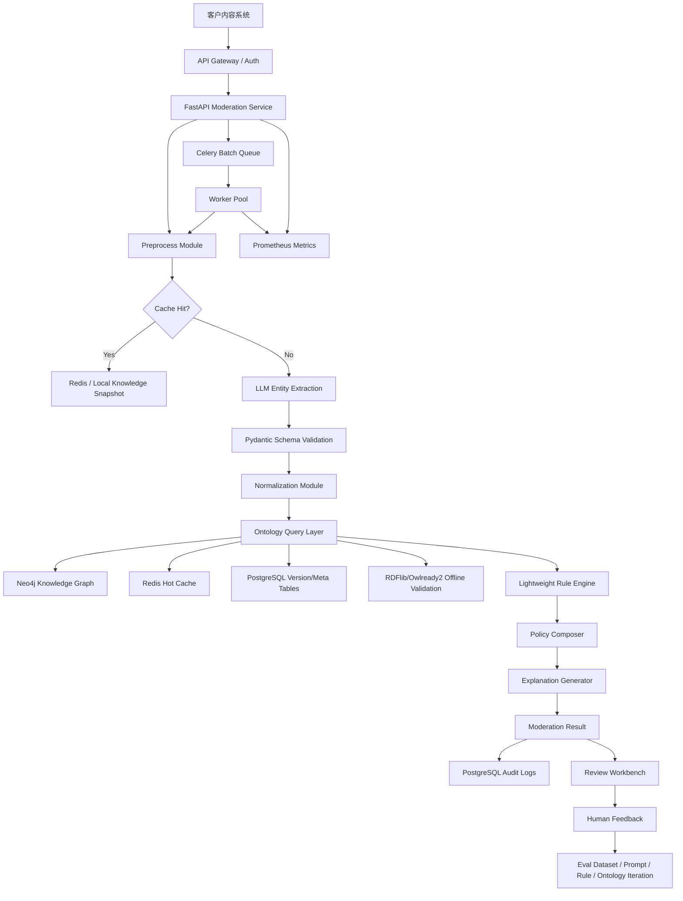

# 岐黄风控盾 QiHuang Shield MVP 技术调研报告

| 字段 | 内容 |
| --- | --- |
| 关联 PRD | `docs/pm/QiHuang_Shield_PRD.md` |
| 调研版本 | v1.0 |
| 调研日期 | 2026-05-29 |
| 调研方法 | 基于 PRD 技术需求 + 项目技术栈检测 + 官方文档/开源项目调研 + 方案对比 |
| 输出目的 | 为后续架构设计、数据模型设计、接口设计、POC 排期提供技术选型依据 |

---

## 1. 调研背景

### 1.1 需求概述

根据 PRD，岐黄风控盾 MVP 需要构建一套面向中医及泛健康内容的 AI 风控引擎，核心链路为：

```text
文本输入 -> 文本预处理 -> LLM/NER 实体抽取 -> 实体归一化 -> 本体查询 -> 规则推理 -> 客户策略合成 -> 审核决策 -> 可解释输出 -> 人工反馈回流
```

MVP 需要支持：

- 同步审核 API：`POST /api/v1/moderation/sync`，目标 P95 <= 800ms（规则/缓存链路）。
- 异步批量审核：单批至少 100 条，批量吞吐目标 >= 1000 条/分钟。
- 中医合规微型本体：约 100 种高频食疗物质 + 约 500 种高风险中药材/非食品物质。
- 三类核心规则：药食同源/原料身份、配伍禁忌、功效宣称越界。
- 可解释审核工作台：Review 列表、证据高亮、命中规则、知识卡片、人工反馈。
- 评测闭环：至少 1000 条评测样本、200 条对抗样本、实体/规则/解释质量指标。

### 1.2 现有技术栈检测结论

当前仓库未检测到业务代码级技术栈文件：

- 未发现 `pyproject.toml`、`requirements.txt`、`package.json`、`Dockerfile`、`docker-compose.yml`。
- 当前仓库主要包含产品与方法论文档目录。
- 因此本报告按“全新 MVP 项目”进行技术选型，但优先选择 Python 生态方案，以匹配仓库路径和 PRD 中的 Python / Owlready2 / RDFlib 方向。

### 1.3 关键技术挑战

| 挑战 | 说明 | 对技术选型的影响 |
| --- | --- | --- |
| 低延迟与 LLM 不确定性并存 | 同步 API 目标 P95 <= 800ms，但 LLM 调用可能超时或波动 | 必须设计规则/缓存/词典降级链路，LLM 不应阻塞所有请求 |
| 结构化抽取质量 | 药材、疾病、功效、剂量、人群、关系抽取需要稳定 JSON 输出 | 需要强 schema 校验、Prompt 版本管理、失败重试与低置信兜底 |
| 本体与规则可解释 | 审核结论必须能解释“命中什么实体、什么规则、什么证据” | 本体、规则、决策日志需版本化并绑定 trace_id |
| 中医知识更新 | 药食同源、禁忌、人群风险等知识需要持续维护 | MVP 可用轻量存储，后续需演进到图数据库或 RDF Store |
| 客户级策略差异 | 不同客户/业务线对 Review/Block 尺度不同 | 规则引擎需要支持策略覆盖、版本、灰度、回滚 |
| 人工反馈闭环 | 误判、漏判、实体错误、解释不可用需回流 | 需要样本库、评测集、标注状态和规则/Prompt 版本关联 |
| 安全合规 | 审核原文、客户数据、审计记录需要隔离与保留策略 | 需要租户隔离、权限、脱敏日志、审计表设计 |

### 1.4 调研目标

- [x] 后端 API 框架选型
- [x] 前端审核工作台技术选型
- [x] LLM 结构化抽取与校验方案
- [x] 本体/知识库存储方案
- [x] 规则引擎方案
- [x] 主业务数据库与缓存方案
- [x] 异步批量任务方案
- [x] 观测、日志、部署方案
- [x] 开源组件复用评估
- [x] MVP 与后续演进路线建议

---

## 2. 技术方案调研

## 2.1 后端 API 框架对比

### 方案对比

| 方案 | 优点 | 缺点 | 适用场景 | 推荐度 |
| --- | --- | --- | --- | --- |
| FastAPI | 原生 async 友好；基于 Python type hints；自动 OpenAPI；与 Pydantic 深度集成；适合 ML/AI 服务 | 团队需要理解 async、依赖注入、Pydantic 模型；复杂后台管理能力需自建 | AI 推理 API、结构化 JSON 服务、低延迟服务 | ⭐⭐⭐⭐⭐ |
| Flask | 轻量、成熟、学习成本低；生态丰富；适合快速原型 | WSGI 为主；类型/schema/文档能力需额外组合；大型服务约定较弱 | 小型管理后台、简单服务、内部工具 | ⭐⭐⭐ |
| Django + DRF | ORM、Admin、权限、认证、后台能力完整 | 框架较重；异步与 AI 服务链路不如 FastAPI 直观；接口性能和灵活性需优化 | 复杂后台系统、强管理台、数据 CRUD 为主 | ⭐⭐⭐⭐ |
| Litestar / Starlite | async、类型友好，设计现代 | 国内团队熟悉度和生态小于 FastAPI | 新项目、追求类型化 API 的团队 | ⭐⭐⭐ |

### 结论

**MVP 推荐：FastAPI。**

选择理由：

1. PRD 的核心是审核 API 和 AI 结构化处理链路，FastAPI 的类型模型、自动 OpenAPI、async 能力更适合此类服务。
2. Pydantic 可同时承担请求校验、LLM 输出校验、响应 schema 生成，减少重复定义。
3. 与 Python AI 生态、RDFlib/Owlready2、Celery/RQ、Prometheus client 的集成成本低。
4. Flask 可作为极简原型备选，但不建议作为主服务框架。
5. Django Admin 对规则/本体后台有吸引力，但 MVP 前期可用 FastAPI + React/AntD Admin，避免引入过重整体框架。

---

## 2.2 前端审核工作台方案对比

### 方案对比

| 方案 | 优点 | 缺点 | 适用场景 | 推荐度 |
| --- | --- | --- | --- | --- |
| React + Vite + Ant Design | 企业后台组件成熟；表格、表单、筛选、弹窗、Tag、高亮展示能力强；构建快；适合审核台 | 需要自建路由、权限、请求封装；设计规范需统一 | 审核工作台、规则配置台、数据报表 | ⭐⭐⭐⭐⭐ |
| Next.js + Ant Design | 全栈能力、路由约定、部署生态好；适合未来 SaaS 前台 | 对 MVP 内部后台略重；SSR/全栈能力不是当前核心需求 | 对外 SaaS、多页面门户、需要 SSR 的场景 | ⭐⭐⭐⭐ |
| Vue 3 + Element Plus | 国内后台系统常见；上手快；组件完整 | 若团队 React 生态更强则切换成本高；与 Ant Design Pro 模板生态不同 | 传统管理后台、Vue 团队 | ⭐⭐⭐⭐ |
| Django Admin | 开发极快，CRUD 成本低 | 审核详情页、证据高亮、知识图谱卡片、交互体验定制弱 | 内部运维后台、早期数据维护 | ⭐⭐⭐ |

### 结论

**MVP 推荐：React + Vite + Ant Design。**

选择理由：

- 审核台和规则台本质是企业后台：筛选表格、详情抽屉、批量操作、表单配置、权限控制、可视化报表较多，Ant Design 适配度高。
- Vite 适合 MVP 快速开发与轻量构建；不需要 Next.js 的 SSR 能力。
- 若团队偏 Vue，可平替为 Vue 3 + Element Plus，不影响后端设计。

---

## 2.3 主业务数据库对比

### 方案对比

| 方案 | 类型 | 优点 | 缺点 | 适用场景 | 推荐度 |
| --- | --- | --- | --- | --- | --- |
| PostgreSQL | 关系型 | 事务可靠；JSONB 支持灵活字段；索引能力强；适合审计、版本、权限、任务状态 | 运维复杂度高于 SQLite；需要 schema 设计 | 审核日志、规则版本、反馈样本、租户策略、评测集 | ⭐⭐⭐⭐⭐ |
| MySQL | 关系型 | 普及度高、团队熟悉、运维成熟 | JSON/复杂查询能力不如 PostgreSQL 灵活；全文/数组/JSONB 场景弱 | 普通业务系统、读多写少 | ⭐⭐⭐⭐ |
| MongoDB | 文档型 | schema 灵活，适合快速变化的 JSON 数据 | 事务和复杂关联不如关系库；审计/版本关系查询需要额外设计 | 原始 LLM 输出、半结构化样本库 | ⭐⭐⭐ |
| SQLite | 嵌入式 | 零运维、适合本地 POC | 并发、权限、租户隔离、线上运维能力有限 | 单机 demo、本地验证 | ⭐⭐ |

### 结论

**MVP 推荐：PostgreSQL。**

建议用途：

- 审核请求与结果表：`moderation_requests`、`moderation_results`。
- 规则与策略表：`rules`、`rule_versions`、`policy_configs`。
- 本体版本元数据：`kb_versions`、`entity_aliases`、`ontology_import_jobs`。
- 人工反馈与评测集：`review_tasks`、`review_feedback`、`eval_samples`。
- LLM 原始输出和中间结果可存 JSONB 字段，兼顾结构化查询和迭代灵活性。

---

## 2.4 缓存与热点知识方案对比

| 方案 | 优点 | 缺点 | 适用场景 | 推荐度 |
| --- | --- | --- | --- | --- |
| Redis | 高性能内存缓存；支持 key-value、hash、set、stream；可做分布式锁和队列辅助 | 需要运维和内存容量管理；持久化策略需明确 | 热点实体属性、规则快照、LLM 结果缓存、异步任务状态 | ⭐⭐⭐⭐⭐ |
| 本地内存缓存 | 极低延迟；实现简单 | 多实例一致性差；发布新规则/知识需要刷新机制 | 单机 POC、只读词典、规则快照 | ⭐⭐⭐ |
| PostgreSQL Materialized View / 表缓存 | 运维简单；一致性好 | 延迟高于内存；刷新策略需设计 | 报表汇总、规则命中统计 | ⭐⭐⭐ |

### 结论

**MVP 推荐：Redis + 进程内只读快照双层缓存。**

- 进程内加载高频别名表、核心规则表、物质身份表，支撑 P95 <= 800ms 的低延迟链路。
- Redis 存储跨实例共享缓存、任务状态、幂等键、LLM 抽取结果缓存。
- 规则/本体发布后通过版本号和广播事件刷新缓存。

---

## 2.5 本体与知识库存储方案对比

### 方案对比

| 方案 | 优点 | 缺点 | 适用场景 | 推荐度 |
| --- | --- | --- | --- | --- |
| Neo4j | 图查询、关系建模、知识卡片、路径解释能力强；适合中医知识图谱与后续 GraphRAG | 需要额外运维和 Cypher 建模能力；不适合作为事务主库 | MVP 知识图谱主查询、知识卡片、关系探索、相似案例检索预留 | ⭐⭐⭐⭐⭐ |
| CSV/JSON + PostgreSQL | 实现简单；便于导入导出、版本管理、人工校验；适合作为事务主库和版本主库 | 图关系表达和多跳查询不自然 | 规则版本、策略配置、审核日志、反馈样本、导入任务 | ⭐⭐⭐⭐⭐ |
| RDFlib | Python 原生 RDF 库；支持 RDF、SPARQL；便于与 Python 服务集成 | 大规模图存储和并发服务能力有限；运维功能弱 | RDF/OWL 解析、离线校验、知识导入转换 | ⭐⭐⭐⭐ |
| Owlready2 | Python OWL 本体对象化；支持 OWL 2.0、本体编辑、HermiT/Pellet 推理 | 推理性能和并发服务需验证；线上服务化需封装 | 本体建模、专家知识维护、离线推理验证 | ⭐⭐⭐⭐ |
| Apache Jena Fuseki | 标准 SPARQL Server；支持 SPARQL 1.1、Graph Store、TDB 持久化 | Java 生态；引入服务和运维复杂度；MVP 学习成本高 | 标准 RDF Store、需要 SPARQL 服务化和语义互操作 | ⭐⭐⭐ |

### 结论

**MVP 推荐：Neo4j + PostgreSQL 双存储，Neo4j 作为知识图谱主查询层，PostgreSQL 作为事务与版本主库。**

推荐分层：

```text
知识源文件层：CSV/JSON/OWL/RDF
    -> 导入校验层：Pydantic schema + RDFlib/Owlready2 解析
    -> 图谱写入层：Neo4j（实体、别名、禁忌、功效、人群、关系路径）
    -> 事务与版本层：PostgreSQL（规则、策略、审核日志、反馈、评测、发布记录）
    -> 热点缓存层：Redis/内存快照
    -> 离线推理层：Owlready2/RDFlib 用于一致性校验和专家验证
```

原因：

- 该产品本质上是“LLM + Ontology + Reasoner”的神经符号风控系统，Neo4j 更符合“知识图谱主查询层”的产品定位。
- 审核工作台存在知识卡片、局部关系展示、后续路径解释和 GraphRAG 演进需求，Neo4j 在这些场景上更自然。
- PostgreSQL 仍然保留为事务主库，负责规则版本、客户策略、审核日志、反馈样本、评测结果，避免把事务型场景强行放进图数据库。
- 同步审核热路径可通过 Redis/进程内快照缓存热点实体和规则，避免每次都做重型图查询。
- RDFlib/Owlready2 继续作为 RDF/OWL 导入、离线校验和专家验证工具，不与在线图谱查询职责冲突。

---

## 2.6 规则引擎方案对比

### 方案对比

| 方案 | 优点 | 缺点 | 适用场景 | 推荐度 |
| --- | --- | --- | --- | --- |
| 自研轻量规则 DSL / 规则表 | 完全贴合业务；可解释性强；易版本化；性能可控；Python 内可直接执行 | 复杂规则能力需逐步建设；需要做好测试和冲突检测 | MVP 三类核心规则、客户级策略覆盖 | ⭐⭐⭐⭐⭐ |
| durable_rules | 支持 Python/Node/Ruby；Rete 前向链推理；适合事件和复杂规则 | PyPI 最新版本较旧，维护活跃度需谨慎；与业务解释模板仍需集成 | 复杂事件/状态规则、实时推理 | ⭐⭐⭐ |
| Drools | 成熟企业级规则引擎；支持 DMN、复杂事件、决策表 | Java 生态，引入重；Python 服务集成成本高；MVP 过度设计 | 大型企业规则治理、复杂决策自动化 | ⭐⭐⭐ |
| json-rules-engine | JSON 规则可持久化；轻量；前端/Node 生态友好 | JS 生态；Python 主服务需要跨语言或重写 | Node 服务、前端规则验证、低复杂度规则 | ⭐⭐⭐ |
| business-rules | Python JSON 规则概念直观，适合业务配置 | 项目维护活跃度一般；复杂规则和性能需验证 | 简单业务规则、内部配置台 | ⭐⭐ |

### 结论

**MVP 推荐：自研轻量规则 DSL / 规则表。**

建议规则表达：

```json
{
  "rule_id": "R003",
  "version": "1.0.0",
  "name": "功效宣称越界",
  "enabled": true,
  "priority": 100,
  "conditions": {
    "all": [
      {"fact": "scenario", "operator": "in", "value": ["food_therapy", "tea_drink"]},
      {"fact": "relation", "operator": "contains", "value": "claims_treatment"},
      {"fact": "target_type", "operator": "equals", "value": "disease"}
    ]
  },
  "action": {
    "decision": "Block",
    "risk_level": "High",
    "explanation_template": "普通食疗/茶饮内容宣称疾病治疗功效，命中功效宣称越界规则。"
  }
}
```

规则引擎能力边界：

- P0：`all/any/not`、`equals/in/contains/range/exists`、优先级、客户策略覆盖。
- P1：规则冲突检测、灰度发布、规则命中统计、解释模板变量。
- P2：可视化规则配置、复杂组合、规则模拟测试。

---

## 2.7 LLM 结构化抽取与校验方案

### 方案对比

| 方案 | 优点 | 缺点 | 适用场景 | 推荐度 |
| --- | --- | --- | --- | --- |
| LLM Structured Outputs / JSON Schema | 强约束输出结构；减少字段缺失和枚举错误；适合实体抽取 | 依赖模型能力；仍需业务校验和置信度策略 | Entity Extraction Agent、Explanation Agent | ⭐⭐⭐⭐⭐ |
| Function Calling / Tool Calling | 适合多工具调用和复杂流程；可绑定函数参数 schema | 对纯抽取任务可能略重；工具链设计复杂 | 需要查询本体、规则模拟、反馈分析的 Agent | ⭐⭐⭐⭐ |
| 普通 JSON Prompt + 正则修复 | 接入简单，模型无特殊要求 | 稳定性差；容易出现非法 JSON；维护成本高 | 早期 demo 或不支持 schema 的模型 | ⭐⭐ |
| 传统 NER 模型 / 小模型 | 延迟低、成本可控、可私有化 | 冷启动需要标注数据；中医/隐喻/新词泛化需训练 | 高频实体抽取、线上降级、后续蒸馏 | ⭐⭐⭐⭐ |

### 结论

**MVP 推荐：LLM Structured Outputs + Pydantic 二次校验 + 词典/规则降级。**

设计原则：

1. LLM 输出必须符合 JSON Schema。
2. 服务端使用 Pydantic 做二次校验、枚举约束、字段范围约束。
3. LLM 只输出实体、关系、置信度、证据位置，不输出最终合规裁判。
4. LLM 超时或失败时，降级到别名词典 + 规则匹配，疑似高风险进入 Review。
5. 对所有 Prompt、schema、模型版本、输入输出、耗时记录 trace，便于复盘。

---

## 2.8 异步批量任务方案对比

| 方案 | 优点 | 缺点 | 适用场景 | 推荐度 |
| --- | --- | --- | --- | --- |
| Celery + Redis/RabbitMQ | 成熟、可靠；支持重试、定时任务、并发 worker；生态和监控工具丰富 | 配置和运维复杂度高于 RQ；任务追踪需规范化 | 批量审核、评测任务、知识导入、离线报表 | ⭐⭐⭐⭐⭐ |
| RQ + Redis | 简单、轻量、学习成本低；适合 Python 函数异步执行 | 复杂路由、定时任务、工作流能力弱于 Celery | POC 批量审核、低复杂度后台任务 | ⭐⭐⭐⭐ |
| arq + Redis | asyncio 友好，适合 FastAPI async 技术栈 | 生态和团队熟悉度通常弱于 Celery/RQ | 全 async 栈、轻量任务队列 | ⭐⭐⭐ |
| Kafka / Pulsar | 高吞吐、事件流、可回放 | 对 MVP 过重；运维复杂 | 大规模内容流处理、实时风控 | ⭐⭐（MVP）/⭐⭐⭐⭐（规模化） |

### 结论

**MVP 推荐：Celery + Redis；极简 POC 可先用 RQ。**

- 如果目标是 1-2 周快速 POC，可用 RQ 降低复杂度。
- 如果从一开始就要支持批量任务、失败重试、任务状态、评测定时跑批、知识导入，建议直接上 Celery。
- 队列任务需要统一 `task_id`、`trace_id`、`tenant_id`、`policy_version`、`kb_version`。

---

## 2.9 可观测性与日志方案对比

| 方案 | 优点 | 缺点 | 适用场景 | 推荐度 |
| --- | --- | --- | --- | --- |
| Prometheus + Grafana | 指标采集和告警成熟；云原生常用；适合 P50/P95/P99、错误率、队列积压 | 日志和 trace 需要额外组件 | API/队列/模型调用监控 | ⭐⭐⭐⭐⭐ |
| OpenTelemetry | 标准化 traces/metrics/logs；便于跨服务链路追踪；供应商中立 | 初期接入成本高于简单日志 | trace_id 全链路、LLM 调用追踪、多服务演进 | ⭐⭐⭐⭐ |
| ELK / OpenSearch | 日志检索强，适合审计和问题定位 | 运维成本较高 | 审核日志、错误日志、审计日志检索 | ⭐⭐⭐⭐ |
| 云厂商 APM | 开箱即用、运维简单 | 厂商绑定；私有化客户不一定可用 | 公有云部署、快速交付 | ⭐⭐⭐ |

### 结论

**MVP 推荐：结构化 JSON 日志 + Prometheus 指标 + trace_id；v1.5 引入 OpenTelemetry。**

最小观测指标：

- API：请求量、状态码、P50/P95/P99、超时率。
- LLM：调用量、成功率、超时率、平均耗时、fallback 率、token 成本。
- 规则：规则命中次数、规则版本、Block/Review/Pass 占比。
- 队列：积压量、任务成功率、任务失败率、重试次数。
- 质量：人工改判率、解释不可用率、实体错误类型。

---

## 2.10 部署方案对比

| 方案 | 优点 | 缺点 | 适用场景 | 推荐度 |
| --- | --- | --- | --- | --- |
| Docker Compose | 简单、适合 POC；可同时启动 API、worker、PostgreSQL、Redis | 多节点、高可用、弹性扩展能力弱 | 本地 POC、单客户试点、演示环境 | ⭐⭐⭐⭐⭐（POC） |
| Kubernetes | 弹性扩展、服务治理、滚动发布、隔离强 | 运维复杂；MVP 初期成本高 | 多客户 SaaS、生产规模化、私有化标准交付 | ⭐⭐⭐⭐（v1.5+） |
| 云函数 / Serverless | 弹性好，按量付费 | LLM 长耗时、队列、本体缓存、私有化支持受限 | 低频异步任务、轻量接口 | ⭐⭐ |
| 单机裸部署 | 成本低、简单 | 可复制性差、运维不可控 | 临时 demo | ⭐ |

### 结论

**POC 推荐 Docker Compose；MVP 商用准备阶段补 Kubernetes Helm 部署。**

---

## 3. 开源方案评估

> Star 数和维护状态基于 2026-05-29 公开页面调研，仅作为选型参考；正式立项前应再次确认 license、版本、漏洞和企业合规要求。

| 开源项目 | 功能 | 当前公开信息摘要 | 维护状态 | 是否采用 | 理由 |
| --- | --- | --- | --- | --- | --- |
| FastAPI | Python API 框架 | 官方定位为现代、高性能、基于类型提示的 API 框架；GitHub 约 98k stars | 活跃 | 是 | 主 API 服务首选 |
| Pydantic | 数据校验与 JSON Schema | 支持基于 Python type hints 的校验和 schema 生成 | 活跃 | 是 | 请求、响应、LLM 输出、本体导入统一校验 |
| PostgreSQL | 主业务数据库 | 支持 JSON/JSONB 与索引，适合关系 + 半结构化混合数据 | 活跃 | 是 | 审核日志、规则、本体元数据、反馈样本 |
| Redis | 缓存/队列辅助 | 支持缓存、数据结构、Stream、Pub/Sub 等 | 活跃 | 是 | 热点知识缓存、任务状态、幂等、分布式锁 |
| RDFlib | Python RDF 库 | Python RDF 处理、SPARQL 查询、序列化 | 活跃 | 是（离线/导入） | 本体文件解析、RDF/OWL 兼容、离线校验 |
| Owlready2 | Python OWL 本体库 | 可加载 OWL 2.0、本体对象化、HermiT/Pellet 推理 | 活跃 | 是（离线/专家工具） | 本体建模和推理验证，不放热路径 |
| Neo4j | 图数据库/GraphRAG | 图查询和 GraphRAG 生态成熟 | 活跃 | 是 | 作为知识图谱主查询层，支撑知识卡片、路径解释和后续 GraphRAG 演进 |
| Apache Jena Fuseki | RDF/SPARQL Server | SPARQL 1.1 查询/更新、Graph Store、TDB 持久化 | 活跃 | 暂不采用 | 标准能力强，但 Java 服务运维成本高，当前优先级低于 Neo4j |
| Celery | 分布式任务队列 | 支持实时处理、任务调度、分布式 worker | 活跃 | 是 | 批量审核、评测跑批、知识导入 |
| RQ | Redis 简单任务队列 | 轻量 Python job queue，依赖 Redis/Valkey | 活跃 | 备选 | POC 极简可用，但复杂任务建议 Celery |
| Prometheus | 指标监控与告警 | 开源系统监控和告警工具 | 活跃 | 是 | API、队列、模型调用指标监控 |
| OpenTelemetry | 标准化观测框架 | 供应商中立，支持 traces/metrics/logs | 活跃 | v1.5 引入 | 多服务链路追踪和私有化可观测标准 |
| Ant Design | React 企业 UI 组件 | 企业级 React 组件库，表单/表格能力强 | 活跃 | 是 | 审核台、规则台、报表后台 |
| Vite | 前端构建工具 | 快速、轻量的现代前端构建工具 | 活跃 | 是 | MVP 前端开发效率高 |
| durable_rules | Python/Node/Ruby 规则引擎 | Rete 前向链规则引擎，GitHub 约 1.3k stars | 一般 | 暂不采用 | PyPI 版本较旧，MVP 自研轻量规则更可控 |
| Drools | 企业规则引擎 | 成熟 BRMS/DMN/CEP | 活跃 | 暂不采用 | Java 生态和运维成本高，MVP 过度设计 |

---

## 4. 推荐技术架构

### 4.1 MVP 推荐技术栈

| 层级 | 推荐方案 | 选择理由 | 备选方案 |
| --- | --- | --- | --- |
| 前端工作台 | React + Vite + Ant Design | 企业后台组件成熟，开发快，适合审核台和规则台 | Vue 3 + Element Plus；Next.js + AntD |
| 后端 API | FastAPI + Pydantic | async、OpenAPI、schema 校验、AI 服务适配度高 | Flask；Django DRF |
| 事务主数据库 | PostgreSQL | 事务、JSONB、审计、规则版本、反馈样本兼顾 | MySQL；MongoDB |
| 图数据库 | Neo4j | 适合实体关系建模、知识卡片、路径查询、GraphRAG 演进 | Apache Jena Fuseki |
| 缓存 | Redis + 进程内快照 | 满足低延迟查询和跨实例缓存 | 本地缓存；PostgreSQL 表缓存 |
| 异步任务 | Celery + Redis | 批量审核、重试、评测、导入任务成熟 | RQ + Redis；arq |
| 本体处理 | Neo4j + PostgreSQL 双存储 + RDFlib/Owlready2 离线校验 | 图谱查询与事务管理分层清晰，同时保留 RDF/OWL 能力 | 仅 PostgreSQL；Neo4j + Jena 双图层 |
| 规则引擎 | 自研轻量规则 DSL / 规则表 | 可解释、可版本化、业务贴合、性能可控 | durable_rules；Drools |
| LLM 抽取 | Structured Outputs + Pydantic 校验 | 稳定 JSON 输出，降低格式错误 | Function Calling；普通 JSON Prompt |
| 监控 | Prometheus + Grafana | 指标监控和告警成熟 | 云监控；OpenTelemetry |
| 日志 | 结构化 JSON 日志 + trace_id | 满足排查、审计、复盘 | ELK/OpenSearch |
| 部署 | Docker Compose（POC）-> Kubernetes（v1.5+） | POC 快速，后续可规模化 | 单机部署；Serverless |

### 4.2 推荐系统架构图



### 4.3 热路径与冷路径拆分

| 路径 | 范围 | 技术策略 |
| --- | --- | --- |
| 同步热路径 | 单条审核 API、规则命中、决策输出 | Redis/进程内快照优先；必要时查询 Neo4j；LLM 超时降级 Review |
| 异步冷路径 | 批量审核、评测、报表、知识导入 | Celery worker；允许调用 LLM、Neo4j 图查询和离线推理；失败可重试 |
| 知识维护路径 | 本体导入、冲突检测、版本发布 | Pydantic 校验 + RDFlib/Owlready2 解析 + Neo4j 写入 + PostgreSQL 版本表 |
| 反馈迭代路径 | 人工改判、误判/漏判分析、评测集更新 | 反馈样本库 + 图谱更新任务 + Prompt/规则版本关联 |

---

## 5. 关键模块技术设计建议

## 5.1 审核 API 服务

### 技术建议

- FastAPI router 按业务域拆分：`moderation`、`batch`、`review`、`rules`、`ontology`、`metrics`。
- 使用 Pydantic 定义完整请求/响应 schema。
- 使用统一异常结构：`error_code`、`message`、`trace_id`、`retryable`。
- 所有请求生成 `trace_id`，贯穿 LLM、规则、本体、日志、反馈。
- 同步接口设置服务端超时预算：
  - 预处理：<= 20ms
  - 缓存/词典命中：<= 50ms
  - 规则推理：<= 100ms
  - 解释生成：<= 80ms
  - LLM 抽取：按客户策略启用，超时进入降级

### 风险

- 如果同步链路每次都调用外部 LLM，P95 <= 800ms 很难稳定达成。
- 建议 MVP 区分两种模式：
  - `fast_mode`：词典/规则/缓存优先，LLM 异步补全或仅低置信触发。
  - `deep_mode`：允许 LLM 同步抽取，适合低 QPS 或人工复核前置场景。

## 5.2 实体抽取与归一化

### 推荐策略

```text
1. 预处理：符号归一、繁简转换、插符号去噪、黑话候选标记
2. 词典召回：标准名、别名、谐音、错别字、模糊匹配
3. LLM 抽取：补充隐喻、功效、关系、剂量、人群
4. 归一化：exact > alias > phonetic > fuzzy > LLM candidate
5. 置信度合成：实体置信度 + 归一置信度 + 规则证据强度
6. 低置信策略：不直接 Block，进入 Review
```

### 建议技术

- 文本处理：Python 标准库 + `regex` + 可选 `opencc`。
- 模糊匹配：`rapidfuzz`。
- schema 校验：Pydantic。
- LLM 输出：JSON Schema / Structured Outputs。
- 后续训练：将反馈样本沉淀为 NER 数据集，考虑小模型蒸馏。

## 5.3 本体和规则数据模型

### MVP 建议表

```text
kb_versions
entities
entity_aliases
entity_attributes
relations
rules
rule_versions
policy_configs
policy_rule_overrides
moderation_requests
moderation_results
review_tasks
review_feedback
eval_samples
eval_runs
audit_logs
```

### 设计原则

- 每次审核结果必须记录：`kb_version`、`rule_version`、`policy_id`、`prompt_version`、`model_version`。
- 规则解释模板与规则版本绑定，避免后续解释漂移。
- 本体导入必须先生成 draft 版本，通过校验后发布。
- 发布后同时更新 Neo4j 图谱版本和 PostgreSQL 元数据版本。
- 发布后生成只读快照，供 API 热路径加载。

## 5.4 规则推理

### 推荐执行顺序

```text
输入事实构建 -> 规则过滤 -> 条件匹配 -> 优先级排序 -> 冲突处理 -> 策略覆盖 -> 解释模板渲染 -> 决策输出
```

### 冲突处理

| 情况 | 策略 |
| --- | --- |
| 同时命中 Pass 与 Review | Review 优先 |
| 同时命中 Review 与 Block | Block 优先，但若实体低置信则降为 Review |
| 多条 Block 规则 | 取最高风险等级，保留所有证据 |
| 客户策略覆盖 | 客户策略优先于默认策略，但不能低于系统安全下限 |

## 5.5 审核工作台

### 前端模块

| 模块 | 技术重点 |
| --- | --- |
| Review 列表 | AntD Table、筛选、分页、批量操作、状态流转 |
| 详情页 | 原文高亮、实体点击卡片、规则解释、证据片段、操作区 |
| 规则管理 | 表单配置、版本列表、规则模拟测试、灰度发布 |
| 本体管理 | CSV/JSON 导入、冲突列表、版本对比、发布审批 |
| 数据大盘 | ECharts/Recharts + 后端聚合接口 |

### 后端接口原则

- 列表接口必须分页、筛选、排序。
- 详情接口一次返回原文、实体、证据、规则、知识卡片所需数据。
- 人工处置接口必须幂等，避免重复提交。
- 所有人工操作写入审计日志。

---

## 6. 技术风险与缓解策略

| 风险 | 影响 | 缓解策略 | 优先级 |
| --- | --- | --- | --- |
| LLM 延迟不稳定 | 同步 API 超时、客户体验差 | 缓存、词典降级、异步补全、fast/deep 模式拆分 | P0 |
| LLM 输出错误或幻觉 | 实体错误、解释错误 | Structured Outputs + Pydantic 校验 + 规则证据约束 | P0 |
| 本体知识错误 | 大规模误判或漏判 | draft/publish 版本机制、专家复核、回滚 | P0 |
| 规则冲突 | 决策不稳定 | 优先级、冲突检测、规则模拟测试 | P0 |
| 误伤过高 | 客户不敢上线自动拦截 | 默认 Review 分流、客户策略可调、人工反馈闭环 | P0 |
| 数据安全问题 | 客户合规风险 | 租户隔离、脱敏日志、保留周期、访问审计 | P0 |
| Neo4j 与 PostgreSQL 双写一致性 | 版本不一致会导致解释和结果漂移 | 采用 draft/publish 发布流程、版本号绑定、异步校验任务 | P1 |
| 规则中台过度复杂 | 延误 MVP | 先用规则表 + JSON DSL，v1.5 再做可视化配置 | P1 |
| 评测集不足 | 无法证明效果 | POC 前构建 1000 条样本，持续加入反馈样本 | P0 |

---

## 7. MVP 实施建议

### 7.1 阶段 1：技术底座与端到端链路（第 1-2 周）

- 搭建 FastAPI 项目结构、Pydantic schema、统一错误结构。
- 搭建 PostgreSQL、Redis、Celery、Docker Compose。
- 实现文本预处理、词典召回、基础实体归一。
- 实现规则 DSL POC：R001/R002/R003。
- 实现同步 API 返回固定结构。
- 建立基础 trace_id 与结构化日志。

### 7.2 阶段 2：AI 抽取与本体导入（第 3-4 周）

- 接入 LLM Structured Outputs。
- 定义实体/关系抽取 schema 和 Prompt 版本。
- 建立 CSV/JSON/OWL 知识导入与校验流程。
- 使用 RDFlib/Owlready2 做离线本体解析/一致性校验。
- 建立 Neo4j 图谱写入与版本发布流程。
- 加入 Redis/内存知识快照。

### 7.3 阶段 3：工作台与反馈闭环（第 5-6 周）

- React + Vite + Ant Design 搭建 Review 列表和详情页。
- 实现证据高亮、命中规则、知识卡片、人工处置。
- 实现反馈类型：误判、漏判、实体错误、规则不适用、解释不清晰。
- 建立评测样本表和评测运行记录。

### 7.4 阶段 4：POC 优化与验收（第 7-12 周）

- 完成 1000 条评测样本、200 条对抗样本。
- 跑通规则效果评估和解释可用率评估。
- 完成性能压测：同步 P95、批量吞吐、队列积压。
- 完成客户策略模板和 POC 报告。

---

## 8. 最终调研结论

### 8.1 推荐选型清单

| 层级 | 最终推荐 | 采纳阶段 | 关键原因 |
| --- | --- | --- | --- |
| 前端 | React + Vite + Ant Design | MVP | 审核/规则后台适配度高，开发效率高 |
| 后端 | FastAPI + Pydantic | MVP | AI API、schema、OpenAPI、async 适配度高 |
| 事务数据库 | PostgreSQL | MVP | 承载规则版本、策略、审核日志、反馈样本和评测数据 |
| 图数据库 | Neo4j | MVP | 承载知识图谱主查询、知识卡片、路径关系和后续 GraphRAG 演进 |
| 缓存 | Redis + 进程内快照 | MVP | 支撑低延迟、本体/规则热数据、任务状态 |
| 异步任务 | Celery + Redis | MVP | 批量审核、评测跑批、知识导入、失败重试 |
| 本体工具 | RDFlib + Owlready2 | MVP | 离线解析、OWL/RDF 兼容、专家校验 |
| 规则引擎 | 自研轻量 JSON DSL | MVP | 业务贴合、可解释、可版本化、性能可控 |
| LLM 输出 | Structured Outputs + Pydantic 校验 | MVP | 提升结构化抽取稳定性 |
| 监控 | Prometheus + Grafana | MVP | 指标和告警成熟 |
| 链路追踪 | trace_id + JSON 日志，v1.5 引入 OpenTelemetry | MVP/v1.5 | 先低成本追踪，后续标准化 |
| 部署 | Docker Compose -> Kubernetes | POC/v1.5 | POC 快速，商用可扩展 |

### 8.2 不建议 MVP 立即采用的方案

| 方案 | 不建议原因 | 后续触发条件 |
| --- | --- | --- |
| Apache Jena Fuseki 作为在线查询服务 | 标准能力强但服务化和 Java 运维成本高 | 客户明确要求 RDF/SPARQL 标准互操作 |
| 仅使用 Neo4j 不保留事务主库 | 审计、规则版本、任务状态、反馈样本管理复杂度高 | 若后续已完成图数据库事务建模与治理体系，再评估是否收敛存储 |
| Drools | 规则治理强但 Java 体系重，和 Python MVP 集成成本高 | 企业客户已有 Drools/DMN 体系，需要对接 |
| 全量同步 LLM 审核 | 延迟和成本不可控 | 低 QPS、客户接受秒级响应，或已有私有化低延迟模型 |
| Kubernetes 起步 | 早期 POC 运维成本高 | 多客户、多实例、私有化交付标准化阶段 |

---

## 9. 调研来源索引

| 领域 | 来源 |
| --- | --- |
| FastAPI | https://fastapi.tiangolo.com/ |
| Flask | https://flask.palletsprojects.com/ |
| Next.js | https://nextjs.org/docs |
| React | https://react.dev/ |
| Vite | https://vite.dev/guide/ |
| Ant Design | https://ant.design/ |
| Material UI | https://mui.com/material-ui/ |
| Element Plus | https://element-plus.org/ |
| PostgreSQL JSON/JSONB | https://www.postgresql.org/docs/current/datatype-json.html |
| RDFlib | https://rdflib.readthedocs.io/ |
| Owlready2 | https://owlready2.readthedocs.io/ |
| Neo4j GraphRAG | https://www.neo4j.com/docs/neo4j-graphrag-python/current/ |
| Apache Jena Fuseki | https://jena.apache.org/documentation/fuseki2/ |
| OpenAI Structured Outputs | https://developers.openai.com/api/docs/guides/structured-outputs |
| Pydantic | https://pydantic.dev/docs/ |
| Celery | https://docs.celeryq.dev/en/stable/ |
| RQ | https://python-rq.org/docs/ |
| Drools | https://docs.drools.org/latest/drools-docs/drools/rule-engine/index.html |
| durable_rules | https://github.com/jruizgit/rules |
| json-rules-engine | https://github.com/CacheControl/json-rules-engine |
| Redis | https://redis.io/docs/latest/ |
| Prometheus | https://prometheus.io/docs/introduction/overview/ |
| OpenTelemetry | https://opentelemetry.io/docs/ |
| SQLAlchemy | https://docs.sqlalchemy.org/ |
