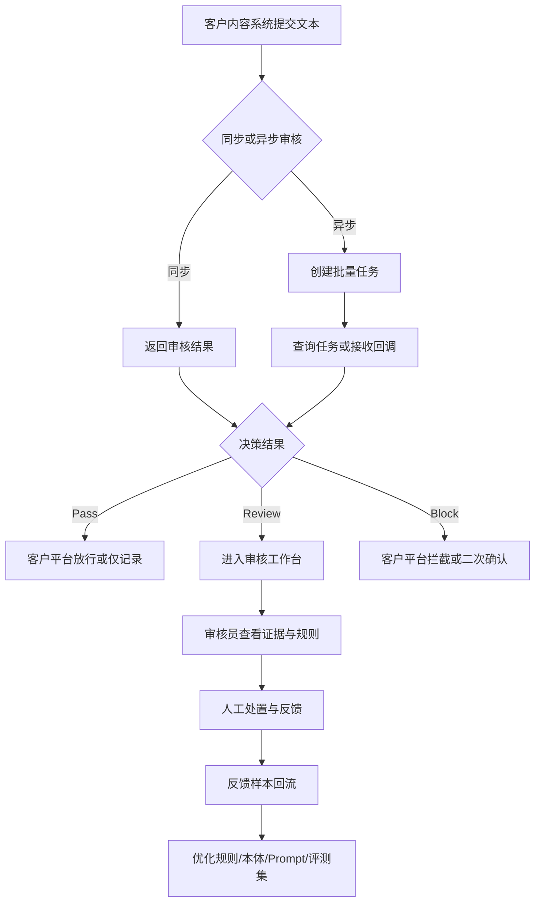
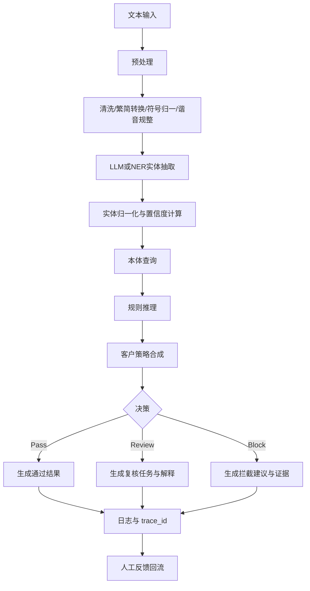
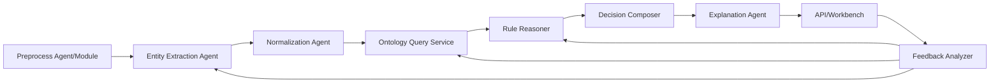
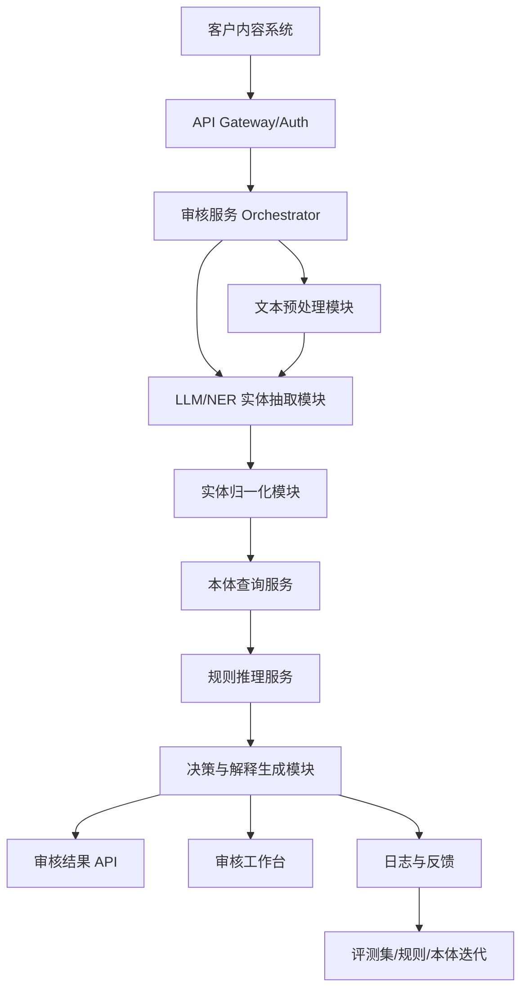

# 产品需求文档（PRD）：岐黄风控盾 QiHuang Shield MVP

| 字段 | 内容 |
| --- | --- |
| 产品名称 | 岐黄风控盾（QiHuang Shield） |
| 文档版本 | v1.1-optimized |
| 产品阶段 | MVP / POC 验证 |
| 目标读者 | 产品、研发、算法、风控运营、交付、客户评审方 |
| 最后更新 | 2026-05-29 |
| 文档状态 | 评审稿 |

---

## 1. 背景与目标

### 1.1 需求背景

小红书、抖音、B站、视频号、电商详情页等平台中，食疗养生、中药茶饮、体质调理、偏方推荐等泛健康内容持续增长。这类内容既具有用户需求，也存在较高的健康安全和平台合规风险：普通敏感词系统无法理解“药材身份、适用场景、功效宣称、剂量人群、配伍禁忌”等专业语义，人工审核又依赖专家经验，成本高、解释难、尺度不稳定。

**岐黄风控盾**的核心任务是：在内容发布、商品上架、评论治理、人工复核等场景中，为客户提供一套**可解释、可配置、可追溯**的中医及泛健康内容合规审核能力。

| 维度 | 当前现状 | 核心痛点 | 产品机会 |
| --- | --- | --- | --- |
| 业务风险 | 泛健康内容增长快，营销表达越来越隐蔽 | 平台容易出现违规功效宣称、危险偏方、非食品原料使用等风险 | 建立面向泛健康内容的垂直风控引擎 |
| 审核效率 | 依赖关键词和人工复核 | 误伤高、漏判高、解释成本高 | 用 LLM 抽取语义，用规则和本体做可解释判定 |
| 专家知识 | 中医知识与食品/广告合规知识分散 | 审核员难以稳定判断药食同源、配伍禁忌、特殊人群风险 | 将专家知识沉淀为可版本化的本体和规则 |
| 客户交付 | 不同客户审核尺度不同 | 同一内容在不同业务线需要不同处置策略 | 支持客户级策略、规则开关、灰度和回滚 |

### 1.2 产品定位

岐黄风控盾是一款基于 **LLM + 中医合规本体（Ontology）+ 可解释规则推理（Reasoner）** 的 AI 风控引擎，面向内容平台、健康社区、电商平台、MCN 机构等客户，提供中医及泛健康内容自动化审核能力。

**定位边界：**
- 系统用于内容安全与合规审核辅助，不提供医疗诊断、治疗建议或个性化用药指导。
- LLM 负责文本理解、实体抽取、语义归一与解释草拟；最终高风险决策必须由规则、本体、客户策略共同支撑。
- 高风险或不确定内容默认进入人工复核，不以 LLM 自由判断直接拦截。

### 1.3 MVP 北极星指标与成功标准

| 指标类型 | 指标 | MVP 目标 | 度量方式 |
| --- | --- | --- | --- |
| 北极星指标 | 有效风险识别率 | 在 POC 测试集中，系统识别出的 Review/Block 样本中，人工认为“有审核价值”的比例 >= 70% | 人工复核标注 |
| 业务指标 | 人工审核提效 | Review 详情页使单条复核平均耗时降低 30% | 客户审核台操作日志 / 对照测试 |
| 效果指标 | 高置信规则准确率 | 配伍禁忌、非药食同源类规则 Precision >= 95% | 标注评测集 |
| 效果指标 | 语义风险识别质量 | 功效宣称越界 Precision >= 90%，Recall >= 85% | 标注评测集 |
| 技术指标 | 同步审核延迟 | P95 <= 800ms（规则与缓存链路）；外部 LLM 链路单独统计 | API 监控 |
| 可解释指标 | 解释可用率 | 审核员认为解释“可理解、可用于判断”的比例 >= 80% | 工作台反馈 |
| 交付指标 | POC 客户验证 | 完成至少 1 家客户真实或仿真数据 POC | POC 验收报告 |

### 1.4 MVP 范围

#### 1.4.1 本期包含

| 模块 | 范围 |
| --- | --- |
| 内容形态 | 纯文本、富文本提取文本、视频/直播转录文本（不含实时音视频处理） |
| 审核链路 | 文本预处理、实体抽取、实体归一化、本体查询、规则推理、决策解释 |
| 重点场景 | 中医减肥/排毒/祛湿；食疗养生与药食同源；中药茶饮/代茶饮/偏方推荐 |
| 规则类型 | 药食同源/原料身份、配伍禁忌、功效宣称越界、剂量与特殊人群风险提示 |
| 决策结果 | `Pass`、`Review`、`Block` 三态 |
| 使用入口 | 同步审核 API、异步批量审核 API、基础审核工作台 |
| 管理能力 | 基础本体维护、规则开关、版本管理、审核日志、人工反馈回流 |

#### 1.4.2 本期不包含

- 实时视频流审核、直播弹幕实时审核。
- 药材图片识别、OCR 图文一致性判断（仅在 v2.0 规划）。
- 完整《中国药典》级别知识覆盖。
- 医疗诊断建议生成、个性化健康判断、处方推荐。
- 面向创作者的申诉产品前台（MVP 仅支持客户侧证据导出）。

### 1.5 术语表

| 术语 | 说明 |
| --- | --- |
| LLM | 大语言模型，用于非结构化文本理解、实体抽取和语义判断。 |
| Ontology | 本体，用于结构化表达物质、疾病、功效、禁忌、合规身份等知识。 |
| Reasoner | 推理机，根据本体关系、规则和客户策略生成审核判断。 |
| NER | 命名实体识别，识别药材、食材、疾病、症状、功效、剂量、人群等实体。 |
| 药食同源 | 既可作为食品又具有传统药用属性的物质类别，实际使用需按客户确认目录与政策版本管理。 |
| 十八反十九畏 | 传统中药配伍禁忌知识，用于提示部分药材组合风险。 |
| XAI | 可解释人工智能，指系统输出可被审核员理解的证据、规则与处置理由。 |
| Pass | 暂未命中风险，可通过或仅记录日志。 |
| Review | 存在不确定或中高风险，需要人工复核。 |
| Block | 命中明确高风险规则，建议客户拦截或二次确认后拦截。 |

---

## 2. 用户画像与典型场景

### 2.1 核心用户画像

| 角色 | 专业背景 | 核心任务 | 当前痛点 | MVP 诉求 |
| --- | --- | --- | --- | --- |
| B 端平台系统 | 内容平台/电商/社区后端系统 | 在发布、评论、商品上架等节点调用审核能力 | 通用风控无法理解中医语义，接口结果缺少业务可解释性 | 稳定 API、低延迟、结构化结果、可追踪日志 |
| 内容审核员 | 客户安全审核专员 | 复核 Review 内容并做处置 | 不知道具体风险点与依据，专家依赖强 | 高亮证据、命中规则、知识依据、处置建议 |
| 风控策略运营 | 客户策略、安全或合规运营 | 调整不同场景的拦截/复核尺度 | 规则修改依赖研发，上线后难回滚 | 规则开关、阈值配置、版本发布和回滚 |
| 知识图谱管理员 | 我方知识工程/合规专家 | 维护药材、功效、禁忌、身份、别名等知识 | 知识分散、版本不可追溯、冲突难发现 | 批量导入、冲突检测、版本管理、审计日志 |
| 客户成功/交付人员 | 售前、售后、POC 支持 | 向客户配置试点场景并解释效果 | 难量化价值，案例难沉淀 | POC 报表、风险案例、误判/漏判分析 |

### 2.2 用户故事与验收标准

#### US1：发布前机器审核

作为内容平台系统，我希望在用户发布中医养生内容前调用审核 API，以便快速判断内容是否可发布。

**验收标准：**
- 支持单条文本同步审核，返回 `decision`、`risk_level`、`hit_rules`、`entities`、`evidence_spans`、`trace_id`。
- 支持批量异步审核，单批至少 100 条，单条失败不影响整批任务。
- API 返回结构稳定，可被客户系统直接解析。

#### US2：人工复核辅助

作为内容审核员，我希望看到系统高亮的药材、疾病、功效宣称、剂量与违规依据，以便快速决定删除、打回、放行或升级专家复核。

**验收标准：**
- 原文支持实体和证据片段高亮。
- 命中规则展示风险类型、判断原因、知识依据、推荐处置。
- 支持人工确认、改判、备注、误判/漏判原因选择。

#### US3：规则策略调整

作为风控策略运营，我希望将某类风险从 Review 调整为 Block，或对不同业务场景配置不同策略，以便匹配平台治理强度。

**验收标准：**
- 支持规则启停、优先级、风险等级、默认决策配置。
- 支持客户级策略覆盖、灰度发布、版本回滚。
- 所有变更记录操作人、时间、变更内容和生效范围。

#### US4：知识库维护

作为知识图谱管理员，我希望导入和维护物质、功效、禁忌、法定身份、别名等知识，以便系统持续适配新风险和新目录。

**验收标准：**
- MVP 支持 CSV/JSON 至少一种格式导入。
- 导入前进行字段校验、重复实体识别和冲突提示。
- 支持知识版本发布、回滚和变更审计。

---

## 3. 业务流程与系统处理流程

### 3.1 用户操作路径

以下流程用于说明客户系统、审核员和策略运营如何在 MVP 中形成闭环。



### 3.2 AI 审核处理链路

以下流程用于说明后端从文本输入到可解释输出的完整处理链路。



### 3.3 决策矩阵

| 条件 | 示例 | 默认决策 | 说明 |
| --- | --- | --- | --- |
| 明确命中高危规则，实体置信度高 | 非药食同源物质用于普通食品配方，并宣称治疗疾病 | Block | 建议自动拦截或客户二次确认后拦截 |
| 命中中高风险规则，但语义存在不确定性 | “喝这个茶改善结节体质” | Review | 交由人工复核，避免误伤 |
| 命中低风险提示 | 泛化养生建议，无具体疾病治疗承诺 | Pass / Review | 根据客户策略配置 |
| 实体置信度低，但文本含高风险暗示 | 谐音、拆字、黑话、隐喻 | Review | 防止对抗绕过 |
| 未命中规则且无明显风险 | 日常食谱、普通养生科普 | Pass | 记录基础日志即可 |

### 3.4 核心规则类型

| 规则编号 | 规则名称 | 触发条件 | 默认决策 | MVP 说明 |
| --- | --- | --- | --- | --- |
| R001 | 药食同源/原料身份校验 | 物质不允许用于当前内容场景，或存在条件限制但文本未体现限制 | Review / Block | 依赖客户确认的白名单、黑名单、条件名单 |
| R002 | 配伍禁忌校验 | 多个药材组合命中十八反、十九畏或内部高风险配伍关系 | Review / Block | 若同时出现长期服用、治疗承诺，则提高风险等级 |
| R003 | 功效宣称越界 | 普通食品、食疗或茶饮宣称治疗、根治、替代药物、消除疾病 | Block | 高风险表达直接进入 Block 建议 |
| R004 | 剂量与人群风险提示 | 包含长期、大剂量、孕妇/儿童/老人/慢病人群使用建议 | Review | MVP 仅做提示，不做复杂剂量医学判断 |
| R005 | 对抗表达识别 | 谐音、拆字、插符号、黑话、隐喻等规避表达 | Review | 与其他规则叠加时提升风险等级 |

### 3.5 对抗样本防御

| 对抗方式 | 示例 | MVP 处理策略 |
| --- | --- | --- |
| 谐音字 | “枸起”“黄齐” | 高频别名表 + 模糊匹配 + 置信度标注 |
| 拆字/插符号 | “甘*草”“海-藻” | 预处理去噪归一，保留原文证据 |
| 黑话隐喻 | “降糖水”“结节茶” | 结合疾病、功效、物质实体做语义识别 |
| 图文分离 | 图片写药材，正文写功效 | MVP 记录能力边界，v2.0 支持 OCR |
| 规避绝对词 | “懂的都懂”“老方子” | 命中高风险场景时进入 Review |

---

## 4. 功能规划

### 4.1 功能优先级

| 优先级 | 模块 | 功能 | 一句话验收标准 |
| --- | --- | --- | --- |
| P0 | 审核 API | 同步审核接口 | 单条文本可返回结构化审核结果和 trace_id |
| P0 | AI 抽取 | 药材/食材/疾病/功效/剂量/人群抽取 | 抽取结果包含标准名、原文位置、置信度 |
| P0 | 本体 | 药食同源与高风险物质库 | 支持首批物质身份、别名、风险属性查询 |
| P0 | 规则 | 三类核心规则 | 支持药食同源、配伍禁忌、功效宣称越界判断 |
| P0 | 解释 | 命中证据与审核说明 | Review/Block 必须返回证据片段和规则依据 |
| P1 | 工作台 | Review 列表与详情页 | 审核员可查看、处置、反馈 Review 内容 |
| P1 | 反馈 | 人工改判回流 | 反馈可沉淀为样本并关联 trace_id |
| P1 | 监控 | 调用量、延迟、错误率 | 核心 API 和队列状态可观测 |
| P2 | 规则中台 | 规则启停和版本 | 策略运营可配置规则并回滚 |
| P2 | 数据大盘 | 风险趋势和报表 | 可展示审核量、命中率、改判率、Top 风险 |
| P3 | 多模态 | OCR/ASR | v2.0 扩展，MVP 不实现实时多模态 |

### 4.2 MVP 里程碑建议

| 阶段 | 周期 | 关键产出 | 验收口径 |
| --- | --- | --- | --- |
| POC 准备期 | 第 1-2 周 | 首批本体、规则表、评测集框架、API 草案 | 内部样例跑通端到端链路 |
| MVP 试运行 | 第 3-6 周 | 同步/异步 API、基础工作台、日志与反馈 | 客户样本可批量评测和复核 |
| MVP 优化期 | 第 7-12 周 | 误判/漏判分析、规则调参、别名扩展 | 达到 POC 效果与解释指标 |
| 商用准备 | 第 13 周+ | 客户级策略模板、部署文档、验收报告 | 支持多客户复制交付 |

---

## 5. 详细功能需求

### 5.1 核心审核 API 服务

#### F1.1 同步审核接口

- **入口**：客户内容系统在发布前、上架前、评论入库前调用。
- **Method**：`POST`
- **Endpoint**：`/api/v1/moderation/sync`
- **超时建议**：客户侧 2s；服务端超过阈值返回降级状态或 Review。

**Request Body**

```json
{
  "content_id": "string - 客户侧内容唯一ID，必填",
  "content_text": "string - 待审核文本，必填",
  "content_type": "string - note|comment|product_detail|transcript|other，选填",
  "scenario": "string - food_therapy|tea_drink|weight_loss|general_health|other，选填",
  "policy_id": "string - 客户策略ID，选填",
  "tenant_id": "string - 租户ID，必填",
  "metadata": {
    "author_id": "string - 作者ID，选填",
    "source": "string - 来源业务线，选填"
  }
}
```

**Response Body**

```json
{
  "status": "success",
  "trace_id": "string",
  "content_id": "string",
  "decision": "Pass|Review|Block",
  "risk_level": "Low|Medium|High|Critical",
  "confidence": 0.92,
  "hit_rules": [
    {
      "rule_id": "R003",
      "rule_name": "功效宣称越界",
      "risk_level": "High",
      "decision": "Block",
      "reason": "普通食疗内容宣称治疗疾病"
    }
  ],
  "entities": [
    {
      "text": "降血糖",
      "standard_name": "降低血糖/糖尿病相关功效",
      "type": "effect_claim",
      "start": 12,
      "end": 15,
      "confidence": 0.91
    }
  ],
  "evidence_spans": [
    {
      "text": "三天降血糖",
      "start": 10,
      "end": 15,
      "rule_id": "R003"
    }
  ],
  "explanation": "内容包含疾病相关功效宣称，且与食疗/茶饮场景组合后风险较高，建议拦截或人工二次确认。",
  "recommended_action": "block_or_manual_confirm"
}
```

**异常处理**

| 场景 | 系统行为 | 返回建议 |
| --- | --- | --- |
| 缺少必填字段 | 不进入审核链路 | `400 invalid_request` |
| 文本为空或过短 | 返回 Pass 或 Review，由策略配置决定 | `success` + `decision` |
| 文本超长 | 截断或异步处理，保留提示 | `413 content_too_large` 或 `Review` |
| LLM 调用超时 | 降级到词典/规则链路，低置信风险进 Review | `success` + `fallback_triggered=true` |
| 本体服务不可用 | 高风险词命中时 Review，否则返回系统错误 | `503 ontology_unavailable` |

#### F1.2 异步批量审核接口

- **入口**：客户批量导入历史内容、商品详情或 POC 测试集。
- **Method**：`POST`
- **Endpoint**：`/api/v1/moderation/batch`
- **能力要求**：单批至少 100 条；任务状态可查询；支持失败重试；单条失败不影响整批任务。

**任务状态枚举**
- `created`：任务已创建。
- `running`：处理中。
- `partial_success`：部分完成，存在单条失败。
- `success`：全部完成。
- `failed`：任务级失败。
- `cancelled`：任务已取消。

#### F1.3 命中标签与解释

当 `decision` 为 `Review` 或 `Block` 时，必须返回：
- 风险类型：如 `配伍禁忌`、`功效宣称越界`、`非药食同源风险`。
- 触发实体：如药材、疾病、功效、剂量、人群。
- 触发原文片段：带 start/end 位置，支持前端高亮。
- 知识依据：规则说明、实体属性、版本号；MVP 不强制展示外部法规原文。
- 推荐处置：`allow`、`reject`、`modify_required`、`expert_review`、`manual_confirm_block`。

### 5.2 可解释性审核工作台

#### F2.1 待办任务大厅

**入口**：审核员登录工作台后进入 Review 列表。

**核心能力**
- 按风险等级、违规类型、提交时间、客户来源、业务场景筛选。
- 支持批量分配审核员、批量标记低风险通过。
- 展示系统建议、人工处置状态、处理 SLA。
- 支持导出复核结果和典型案例。

**列表字段**
| 字段 | 说明 |
| --- | --- |
| 内容 ID | 客户侧内容唯一标识 |
| 摘要 | 原文前 100 字或自动摘要 |
| 决策 | Review / Block 建议 |
| 风险等级 | Low / Medium / High / Critical |
| 命中规则 | 规则名称与数量 |
| 客户/业务线 | 租户和来源场景 |
| 提交时间 | 客户调用时间 |
| 处理状态 | 待处理 / 处理中 / 已完成 / 已升级 |

#### F2.2 智能辅助审核详情页

| 区域 | 功能 | 交互要求 |
| --- | --- | --- |
| 原文展示区 | 展示原文并高亮药材、疾病、功效、剂量、特殊人群 | 点击高亮实体后展示标准名、类型、置信度 |
| 风险解释区 | 展示命中规则、风险等级、证据片段和解释 | 支持按规则展开/收起 |
| 知识卡片 | 展示局部知识关系，如“物质-身份-禁忌-关联功效” | 展示知识版本与最后更新时间 |
| 处置区 | 确认违规、忽略通过、打回修改、升级专家复核 | 必须记录操作人与备注 |
| 反馈区 | 标注误判、漏判、实体错误、规则不适用、解释不清晰 | 反馈绑定 trace_id 与规则版本 |

### 5.3 本体与规则管理中台

#### F3.1 本体管理

**实体范围**
- 药材、食材、普通食品、保健食品原料。
- 疾病、症状、功效、体质、特殊人群。
- 禁忌关系、配伍关系、法定/合规身份关系。

**能力要求**
- 支持 CSV/JSON 批量导入。
- 支持别名、俗名、错别字、谐音词维护。
- 支持实体合并、重复检测、冲突检测。
- 支持版本发布、版本回滚、变更审计。
- 支持导入前校验：字段缺失、枚举非法、重复标准名、关系目标不存在。

#### F3.2 动态规则引擎

**示例规则表达**

```text
IF entity.type = "ordinary_food"
AND relation = "claims_treatment"
AND target.type = "disease"
THEN decision = "Block"
AND risk_level = "High"
```

**能力要求**
- 支持规则启用/停用、优先级、风险等级、默认处置。
- 支持客户级策略覆盖：同一规则在不同客户可配置为 Review 或 Block。
- 支持灰度发布、版本回滚、规则命中统计。
- 支持规则解释模板，确保前端展示一致。

#### F3.3 数据大盘与报表

| 报表 | 指标 |
| --- | --- |
| 风控态势 | 审核总量、Pass/Review/Block 占比、拦截率、Review 率 |
| 风险分布 | 高频风险场景、Top 药材、Top 疾病、Top 功效词、Top 规则 |
| 质量分析 | 人工改判率、误判类型、漏判类型、解释不可用率 |
| 客户维度 | 客户调用趋势、风险趋势、策略版本命中效果 |
| 系统稳定性 | P50/P95/P99 延迟、错误率、队列积压、LLM 调用成功率 |

---

## 6. Agent / AI 组件设计

> 说明：MVP 不把 LLM 作为最终合规裁判。AI 组件负责抽取、归一、解释草拟和反馈分析；所有高风险结论必须由规则、本体、客户策略支撑。

### 6.1 组件协作图



### 6.2 Entity Extraction Agent

#### Role
识别中医及泛健康文本中的结构化实体和关系，包括物质、疾病、症状、功效、剂量、频次、疗程、特殊人群、推荐动作等。

#### Inputs
- `content_text`: 待审核文本。
- `scenario`: 业务场景。
- `alias_dictionary_version`: 别名词典版本。
- `extraction_schema`: 实体与关系输出 schema。

#### Action Path
1. 对文本进行分句和上下文理解。
2. 抽取实体、实体类型、原文位置、置信度。
3. 抽取关系：物质-功效、物质-疾病、物质-人群、物质-剂量、推荐动作等。
4. 标记不确定实体和疑似对抗表达。
5. 输出严格 JSON，不输出自由医学建议。

#### Output Specifications
```json
{
  "entities": [
    {
      "text": "string",
      "type": "material|food|disease|symptom|effect_claim|dosage|frequency|duration|population|action",
      "start": 0,
      "end": 0,
      "confidence": 0.0,
      "is_adversarial_suspected": false
    }
  ],
  "relations": [
    {
      "subject_text": "string",
      "predicate": "claims|treats|uses|contraindicated_for|dosage_for",
      "object_text": "string",
      "confidence": 0.0
    }
  ]
}
```

#### Constraints
- 不生成治疗建议。
- 不自行判定最终 Pass/Review/Block。
- 低置信实体必须保留并标记，不可直接丢弃。

### 6.3 Normalization Agent

#### Role
将抽取实体映射到标准实体，处理别名、繁简、错别字、谐音、拆字和近似表达。

#### Inputs
- `entities`: 抽取实体列表。
- `ontology_index`: 标准实体索引。
- `alias_table`: 别名与谐音表。

#### Output Specifications
```json
{
  "normalized_entities": [
    {
      "raw_text": "黄耆",
      "standard_name": "黄芪",
      "entity_id": "MAT_0001",
      "match_type": "exact|alias|fuzzy|phonetic|unknown",
      "confidence": 0.0,
      "candidates": []
    }
  ]
}
```

### 6.4 Explanation Agent

#### Role
基于规则命中结果、证据片段和知识属性生成审核员可理解的解释，不添加规则之外的医学推断。

#### Inputs
- `decision_result`: 决策结果。
- `hit_rules`: 命中规则列表。
- `evidence_spans`: 原文证据。
- `ontology_facts`: 本体查询事实。
- `policy_config`: 客户策略。

#### Constraints
- 解释必须引用已命中的规则或本体事实。
- 不输出“建议服用/调整剂量/替代治疗”等医疗建议。
- 无证据时不得生成看似确定的违规理由，应返回“证据不足，建议人工复核”。

---

## 7. 数据与知识库需求

### 7.1 MVP 微型本体范围

#### 7.1.1 物质本体
- 约 100 种高频食疗/养生物质，如枸杞、人参、黄芪、山药、茯苓等。
- 约 500 种常见中药材或非食品使用高风险物质。
- 支持标准名、别名、俗名、错别字、谐音词、风险标签。

#### 7.1.2 关系本体
- 配伍关系：相须、相使、相畏、相杀、相恶、相反。
- 功效关系：清热、祛湿、补气、活血等。
- 主治/关联疾病关系。
- 禁忌人群关系。
- 合规身份关系。

#### 7.1.3 合规属性本体

| 属性 | 示例 | 说明 |
| --- | --- | --- |
| `entity_id` | `MAT_0001` | 标准实体 ID |
| `standard_name` | 黄芪 | 标准名称 |
| `alias` | 黄耆、北芪 | 别名列表 |
| `material_type` | 药材 / 食材 / 保健食品原料 | 业务分类 |
| `food_allowed` | true / false / conditional | 当前知识版本下的食品使用判断 |
| `risk_level` | Low / Medium / High | 基础风险等级 |
| `prohibited_context` | 普通食品、茶饮、孕妇人群 | 禁止或限制场景 |
| `evidence_source` | 内部知识来源或客户确认来源 | MVP 可先记录来源备注 |
| `version` | `kb_2026_05_29` | 知识版本号 |

### 7.2 标注与评测数据

| 项目 | MVP 要求 |
| --- | --- |
| 数据规模 | 至少 1000 条真实或仿真中医/泛健康内容 |
| 场景覆盖 | 中医减肥/排毒/祛湿；食疗养生；中药茶饮/偏方 |
| 对抗样本 | 至少 200 条，覆盖谐音、拆字、隐喻、规避表达 |
| 标注字段 | 实体、标准名、关系、命中规则、风险等级、期望决策、解释是否可用 |
| 初标角色 | 产品/运营/标注人员 |
| 复核角色 | 中医知识专家或合规专家 |
| 仲裁机制 | 产品负责人 + 专家联合确认争议样本 |

### 7.3 评测指标

| 评测维度 | 指标 | 通过标准 |
| --- | --- | --- |
| 实体识别 | Precision / Recall / F1 | P >= 90%，R >= 85% |
| 实体归一 | Top-1 Accuracy | >= 90% |
| 配伍禁忌 | Precision / Recall | P >= 95%，R >= 90% |
| 非药食同源风险 | Precision / Recall | P >= 95%，R >= 90% |
| 功效宣称越界 | Precision / Recall | P >= 90%，R >= 85% |
| 决策质量 | 人工改判率 | MVP 阶段持续下降，POC 需给出基线与目标 |
| 解释质量 | 解释可用率 | >= 80% |

---

## 8. 非功能需求

### 8.1 性能与容量

| 指标 | MVP 目标 | 说明 |
| --- | --- | --- |
| 同步 API P95 延迟 | <= 800ms | 包含规则推理和轻量 LLM/缓存链路；外部大模型需单独统计 |
| 规则推理 P95 延迟 | <= 100ms | 已完成实体抽取后的推理耗时 |
| 单节点 QPS | >= 100 | MVP 阶段目标，后续压测优化 |
| 批量任务吞吐 | >= 1000 条/分钟 | 异步处理场景 |
| 可用性 | >= 99.5% | POC/MVP 阶段目标 |

### 8.2 安全与合规

- API 提供 AK/SK 或 OAuth2 鉴权。
- 支持客户级数据隔离，日志和样本按租户隔离。
- 原始审核内容默认仅保留必要周期，支持按客户配置销毁策略。
- 审核日志脱敏展示，敏感字段访问需权限控制。
- 规则、本体、策略变更必须记录审计日志。
- 系统输出仅作为内容审核辅助，不构成医疗诊断、治疗建议或用药指导。

### 8.3 可观测性与告警

| 告警项 | 阈值 | 等级 | 处理建议 |
| --- | --- | --- | --- |
| API 错误率 | 连续 5 分钟 > 1% | P1 | 通知值班研发，检查网关与服务依赖 |
| 同步接口 P95 | 连续 10 分钟 > 2s | P2 | 降级外部 LLM，启用缓存/规则链路 |
| LLM 调用失败率 | 连续 5 分钟 > 5% | P1 | 切换备用模型或进入 Review 降级 |
| 异步队列积压 | 超过阈值持续 10 分钟 | P2 | 扩容 worker，限制新增批量任务 |
| Block 率异常波动 | 高于近 7 日均值 2 倍 | P2 | 检查规则版本、客户策略、输入流量变化 |

---

## 9. 兜底策略

| 触发条件 | 系统行为 | 用户/客户感知 |
| --- | --- | --- |
| LLM 超时或失败 | 启用词典 + 规则降级链路；命中高风险词进入 Review | API 返回 `fallback_triggered=true`，工作台展示“AI 抽取降级” |
| 实体归一置信度低 | 保留候选实体，不直接 Block | 决策倾向 Review，解释中标注“不确定实体” |
| 本体服务不可用 | 使用最近一次可用缓存；缓存缺失时返回 Review 或服务错误 | trace_id 可定位，监控告警 |
| 规则冲突 | 按最高风险规则优先；同时展示冲突规则 | 工作台提示“存在规则冲突，建议人工复核” |
| 文本超长 | 按段落切分审核并合并最高风险结果 | 返回分段证据与整体决策 |
| 输入为空或无意义 | 按客户策略返回 Pass 或 Review | 返回解释：“内容不足，未进行完整审核” |
| 命中能力边界 | 如图片药材、视频画面、直播实时内容 | 返回 Review 或能力边界提示 |

---

## 10. 埋点与运营指标

| 阶段 | 埋点 ID | 事件名称 | 触发条件 | 关键属性 |
| --- | --- | --- | --- | --- |
| API 调用 | `moderation_request` | 审核请求创建 | 客户调用同步/异步接口 | tenant_id、scenario、content_type、policy_id |
| API 返回 | `moderation_result` | 审核结果返回 | 系统返回结果 | decision、risk_level、latency、fallback_triggered |
| 规则命中 | `rule_hit` | 规则命中 | 任一规则命中 | rule_id、rule_version、entity_type、decision |
| 工作台 | `review_task_open` | 打开复核任务 | 审核员进入详情页 | task_id、risk_level、hit_rules_count |
| 人工处置 | `review_task_submit` | 提交人工处置 | 审核员确认结果 | action、is_overwrite_system_decision、reason |
| 反馈 | `feedback_created` | 创建反馈样本 | 审核员标注误判/漏判等 | feedback_type、rule_id、entity_id |
| 策略 | `policy_publish` | 策略发布 | 策略运营发布规则版本 | policy_id、version、operator、scope |

---

## 11. 角色权限

| 角色 | API 调用 | 查看工作台 | 人工处置 | 规则配置 | 本体维护 | 报表查看 | 审计查看 |
| --- | --- | --- | --- | --- | --- | --- | --- |
| 客户系统 | 是 | 否 | 否 | 否 | 否 | 否 | 否 |
| 审核员 | 否 | 是 | 是 | 否 | 否 | 部分 | 否 |
| 风控策略运营 | 否 | 是 | 部分 | 是 | 否 | 是 | 部分 |
| 知识图谱管理员 | 否 | 否 | 否 | 部分 | 是 | 部分 | 是 |
| 客户成功/交付 | 否 | 只读 | 否 | 只读 | 否 | 是 | 否 |
| 系统管理员 | 是 | 是 | 是 | 是 | 是 | 是 | 是 |

---

## 12. 技术架构建议

### 12.1 MVP 架构



### 12.2 技术选型建议

| 模块 | MVP 建议 | 后续演进 |
| --- | --- | --- |
| API 服务 | FastAPI / Flask | 微服务化、网关治理 |
| 实体抽取 | LLM Prompt + 规则词典 | 微调模型、小模型蒸馏 |
| 本体与知识存储 | Neo4j（知识图谱查询）+ PostgreSQL（版本/事务）+ RDFlib/Owlready2（离线校验） | GraphRAG / RDF Store / 独立 Graph Service |
| 规则推理 | Python 规则引擎 / 规则表 | 可视化规则引擎 / DSL |
| 审核工作台 | 简单 Web Admin | 多租户 SaaS 工作台 |
| 日志分析 | 数据库 + Dashboard | OLAP / 实时数仓 |
| 监控告警 | Prometheus + Grafana 或云监控 | 全链路追踪 |

### 12.3 LLM 使用边界

- LLM 输出必须结构化，并经过 schema 校验。
- 高风险决策必须由规则或本体证据支撑。
- 不允许仅凭 LLM 自由生成结论直接 Block。
- LLM 不生成医疗建议、剂量建议、治疗建议。
- 低置信度、证据不足、能力边界内的内容进入 Review。

---

## 13. POC 验收标准

### 13.1 功能验收

- 支持同步审核 API。
- 支持异步批量审核任务。
- 支持至少 3 类核心风险规则：药食同源/原料身份、配伍禁忌、功效宣称越界。
- 支持实体抽取、归一化和证据高亮。
- 支持 `Pass` / `Review` / `Block` 三态输出。
- 支持基础审核工作台和人工复核结果回流。
- 支持 trace_id 追踪、基础监控和错误定位。

### 13.2 效果验收

- 在客户提供或双方确认的测试集上完成评测。
- 配伍禁忌和非药食同源场景 Precision 达到 95% 左右。
- 功效宣称越界场景 Precision 达到 90% 左右。
- Review 样本中人工认为“有审核价值”的比例不低于 70%。
- 系统解释被审核员认为“可理解、可用于判断”的比例不低于 80%。

### 13.3 性能验收

- 同步接口 P95 延迟满足客户 POC 要求。
- 异步批量任务可稳定完成，单条失败不影响整批结果。
- 日志可追踪，错误可定位。
- 支持单客户隔离部署或租户隔离。

---

## 14. 上线与演进路线

### v1.0 MVP：规则与解释跑通

**目标**：验证核心审核闭环和客户价值。

**范围**
- 构建药食同源、非食品物质、十八反十九畏等微型本体。
- 建立 Neo4j + PostgreSQL 双存储的知识发布链路，并结合 Redis/内存快照支撑热路径查询。
- 实现 LLM 实体抽取、实体归一化、规则推理。
- 发布同步/异步审核 API。
- 发布简易审核工作台。
- 建立评测集和反馈闭环。

### v1.5：策略动态化与客户化

**目标**：支持多客户、多策略、多规则版本管理。

**范围**
- 上线规则管理中台。
- 支持客户自定义审核严苛度。
- 引入规则灰度和版本回滚。
- 建立客户级报表。
- 增强 Neo4j 的知识卡片、路径解释与图谱分析能力，评估 GraphRAG / RDF Store。

### v2.0：多模态与场景扩展

**目标**：扩展到短视频、直播、电商商品详情等复杂内容场景。

**范围**
- 支持 OCR 和 ASR 审核。
- 支持图文一致性判断。
- 扩展至更多中医方剂、疾病、保健食品规则。
- 引入相似案例检索。
- 支持更细粒度的申诉与解释报告。

---

## 15. 待确认问题

| 编号 | 问题 | 影响范围 |
| --- | --- | --- |
| Q1 | MVP 首个客户的具体内容形态是笔记、评论、商品详情还是视频转录？ | 接口字段、评测集、场景策略 |
| Q2 | 客户默认策略偏严格还是偏宽松？ | Review/Block 阈值、误伤控制 |
| Q3 | `Block` 是否允许系统自动执行，还是必须由客户平台二次确认？ | 决策策略、接口推荐动作 |
| Q4 | 药食同源、保健食品原料、禁止食品使用物质等知识来源由我方维护还是客户共同确认？ | 本体版本、责任边界 |
| Q5 | 是否需要支持私有化部署？ | 架构、运维、安全合规 |
| Q6 | 审核日志和原文内容的保留周期要求是多少？ | 存储、隐私、安全策略 |
| Q7 | POC 评测集由客户提供，还是由我方构建后双方确认？ | 验收口径、效果指标 |
| Q8 | 是否需要为不同业务线配置不同规则策略？ | 多策略模型、规则中台优先级 |
| Q9 | 工作台是否接入客户现有账号体系？ | 权限、SSO、审计 |
| Q10 | 解释中是否需要展示外部法规/目录原文链接或仅展示内部知识依据？ | 知识来源管理、前端展示 |
